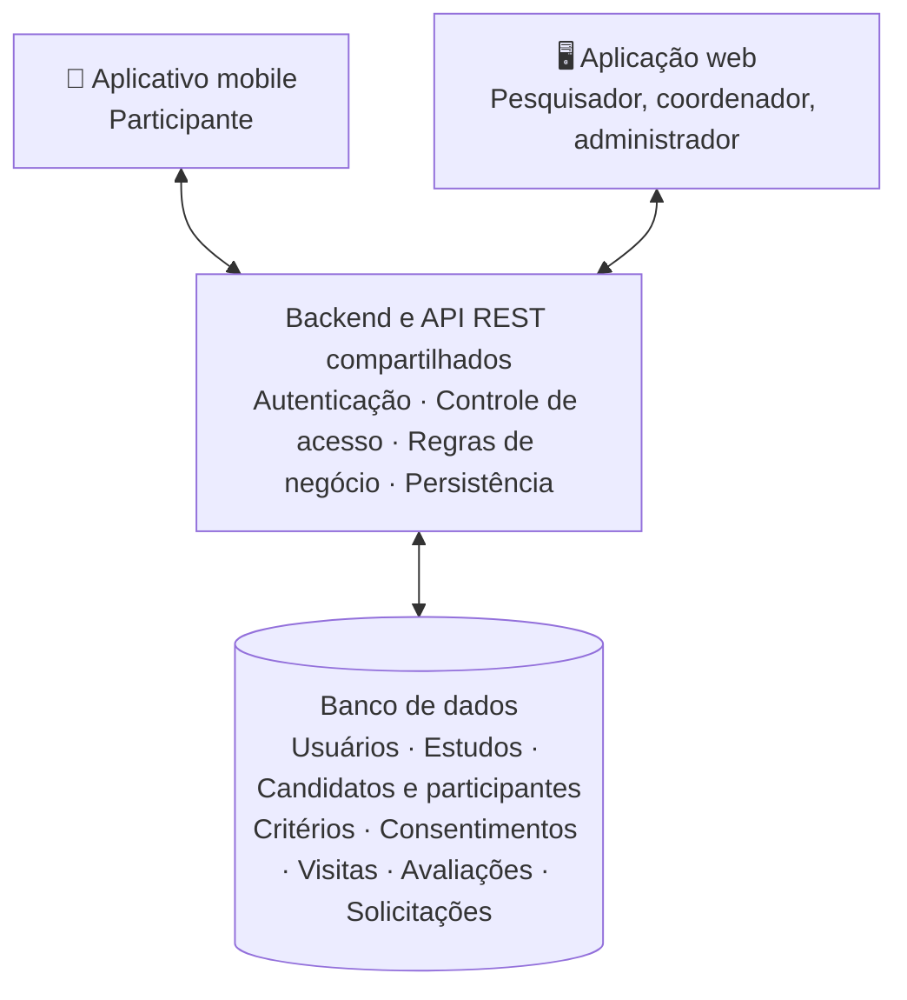

# ClinicalStudyPB — Sistema de Gestão de Estudos Clínicos

> Projeto de Engenharia de Software II — 2026.2

## 1. Visão geral

O **ClinicalStudyPB** é um sistema simplificado para gerenciar o ciclo de vida operacional de estudos clínicos: do cadastro de um protocolo de pesquisa ao acompanhamento dos participantes e encerramento do estudo.

- **Não** realiza diagnósticos nem decisões clínicas automatizadas.
- Apoia a organização, execução e acompanhamento dos estudos.
- Utiliza **dados fictícios**.

Abrange: cadastro de protocolos, recrutamento, elegibilidade, inclusão de participantes, agendamento de visitas, acompanhamento e relatórios.

## 2. Perfis de usuários

| Perfil | Interface | Responsabilidades |
|---|---|---|
| **Participante** | Mobile | Consulta visitas agendadas, acompanha sua participação, registra informações solicitadas e pode solicitar retirada do estudo. |
| **Pesquisador** | Web | Cadastra protocolos, define critérios de elegibilidade, acompanha participantes, consulta dados e gera relatórios. |
| **Coordenador do Estudo** | Web | Gerencia recrutamento, verifica elegibilidade, organiza visitas, acompanha pendências e monitora o andamento. |
| **Administrador** | Web | Gerencia usuários, perfis de acesso, configurações e registros de auditoria. |

## 3. Arquitetura geral



## 4. Requisitos funcionais

### Módulo A — Usuários e autenticação
| ID | Requisito | Interface |
|---|---|---|
| RF01 | Cadastrar e gerenciar usuários com perfis de pesquisador, coordenador, administrador e participante. | Web |
| RF02 | Permitir autenticação e encerramento de sessão. | Web/Mobile |
| RF03 | Restringir funcionalidades conforme o perfil do usuário. | Web/Mobile |

### Módulo B — Gestão de estudos
| ID | Requisito | Interface |
|---|---|---|
| RF04 | Cadastrar estudos com título, objetivo, responsável, datas e limite de participantes. | Web |
| RF05 | Definir critérios de inclusão e exclusão para cada estudo. | Web |
| RF06 | Definir visitas previstas e suas atividades. | Web |
| RF07 | Gerenciar os estados do estudo: planejamento, recrutamento, execução e encerrado. | Web |

### Módulo C — Recrutamento
| ID | Requisito | Interface |
|---|---|---|
| RF08 | Cadastrar candidatos vinculados a um estudo. | Web |
| RF09 | Registrar a avaliação dos critérios de elegibilidade. | Web |
| RF10 | Registrar o consentimento simulado do candidato. | Web |
| RF11 | Incluir candidatos elegíveis e com consentimento registrado, respeitando o limite de vagas. | Web |

### Módulo D — Acompanhamento
| ID | Requisito | Interface |
|---|---|---|
| RF12 | Agendar visitas para os participantes incluídos. | Web |
| RF13 | Registrar a realização, ausência ou cancelamento de visitas. | Web |
| RF14 | Registrar resultados fictícios das avaliações previstas. | Web |
| RF15 | Consultar o histórico de visitas e avaliações de um participante. | Web |
| RF16 | Registrar a retirada de um participante do estudo. | Web |

### Módulo E — Aplicativo do participante
| ID | Requisito | Interface |
|---|---|---|
| RF17 | Consultar os estudos em que está incluído. | Mobile |
| RF18 | Exibir as próximas visitas e o histórico de comparecimento. | Mobile |
| RF19 | Confirmar presença prevista ou solicitar reagendamento de visita. | Mobile |
| RF20 | Solicitar retirada voluntária do estudo. | Mobile |

### Módulo F — Monitoramento
| ID | Requisito | Interface |
|---|---|---|
| RF21 | Exibir painel com quantidade de candidatos, participantes incluídos e visitas realizadas ou pendentes. | Web |
| RF22 | Gerar relatório simplificado de recrutamento e acompanhamento por estudo. | Web |

> **Requisito surpresa:** será definido pela professora durante a Release 3.

### Requisitos por perfil

| Perfil | Requisitos |
|---|---|
| Todos | RF02, RF03 (login/logout e acesso conforme permissões) |
| Participante (Mobile) | RF17, RF18, RF19, RF20 |
| Administrador (Web) | RF01 |
| Pesquisador (Web) | RF04, RF05, RF06, RF07, RF14, RF15, RF21, RF22 |
| Coordenador (Web) | RF08–RF13, RF15, RF16, RF21, RF22 |

## 5. Equipe (6 integrantes)

| # | Papel | Responsabilidades |
|---|---|---|
| 1 | Líder técnico / Gerente | Arquitetura, API, integração e decisões técnicas |
| 2 | Desenvolvedor Backend | Regras de negócio, persistência e testes |
| 3 | Desenvolvedor Web | Telas de estudos, protocolos e usuários |
| 4 | Desenvolvedor Web | Telas de recrutamento, visitas e relatórios |
| 5 | Desenvolvedor Mobile | Aplicativo do participante |
| 6 | QA / DevOps | Testes, integração contínua, qualidade e suporte à implementação |

Todos compartilham planejamento, documentação e acompanhamento das sprints. O papel de QA **não** significa que só um integrante desenvolve testes.

## 6. Cronograma

| Release | Sprints | Período | Data de entrega | Foco |
|---|---|---|---|---|
| **Release 1** — Estrutura e recrutamento | 1 e 2 | 13/10 a 09/11 | 09/11/2026 | RF01–RF11 |
| **Release 2** — Acompanhamento e mobile | 3 e 4 | 10/11 a 07/12 | 07/12/2026 | RF12–RF22 |
| **Release 3** — Manutenção evolutiva | 5 e 6 | 08/12–17/12 e 02/02–11/02 | 11/02/2027 | Projeto de outra equipe + requisitos surpresa |

### Sprints

- **Sprint 1 (13/10–26/10):** repositório e arquitetura; estrutura inicial de backend, web e mobile; RF01–RF04 (usuários, autenticação, autorização, cadastro de estudos); protótipos navegáveis.
- **Sprint 2 (27/10–09/11):** RF05–RF11 (critérios, visitas previstas, estados, recrutamento, elegibilidade, inclusão); integração web–backend; testes e correção de defeitos.
  **Entrega:** web funcional para cadastrar estudo, avaliar candidatos e incluir participantes.
- **Sprint 3 (10/11–23/11):** RF12–RF16 (agendamento, acompanhamento, retirada); login mobile; RF17 e RF18 no app.
- **Sprint 4 (24/11–07/12):** RF19–RF20 (confirmação, reagendamento, retirada pelo mobile); RF21–RF22 (painel e relatórios); integração completa web/mobile/backend; testes integrados.
  **Entrega:** interfaces web e mobile funcionais com fluxo de acompanhamento completo.
- **Sprint 5 (08/12–17/12):** troca de projetos entre equipes; análise da arquitetura e do código recebido; execução dos testes existentes; identificação de problemas e plano de manutenção; definição dos requisitos surpresa.
- **Sprint 6 (02/02–11/02):** implementação dos novos requisitos; refatoração; testes de regressão; atualização de diagramas e documentação; apresentação final.
  **Entrega:** versão evoluída do sistema desenvolvido por outra equipe.

## 7. Stack tecnológico

Cada equipe escolhe livremente entre os stacks abaixo.

| | Backend | Web | Mobile | Banco | Testes |
|---|---|---|---|---|---|
| **A — Java + React** | Spring Boot | React + TypeScript | React Native + Expo | PostgreSQL | JUnit, Mockito, Vitest, Jest, Playwright |
| **B — TypeScript Full Stack** | NestJS | React | React Native + Expo | PostgreSQL | Jest, Supertest, Vitest, Playwright |
| **C — Python + Vue + Flutter** | FastAPI | Vue.js | Flutter | PostgreSQL | pytest, HTTPX, Vitest, flutter_test |

- **A:** boa para explorar orientação a objetos no backend e compartilhar conhecimento de TypeScript entre web e mobile.
- **B:** reduz o número de linguagens e permite compartilhar tipos, validações e conhecimento.
- **C:** backend produtivo e interfaces modernas, mas exige Python, TypeScript e Dart.

> O mobile só precisa executar em emulador ou dispositivo; não é necessário publicar nas lojas.

### Regras para a escolha tecnológica

1. Escolha livre entre os stacks sugeridos.
2. API HTTP REST compartilhada por web e mobile, documentada em **OpenAPI** (Swagger UI).
3. Web atende pesquisador, coordenador e administrador.
4. Mobile atende o participante (dispositivo ou emulador).
5. Persistência de dados e controle de acesso por perfil.
6. Testes automatizados com evidências de cobertura.
7. Documentação de instalação e execução, para outra equipe assumir na Release 3.
8. Tecnologias documentadas e justificadas na Sprint 1.

## 8. Estratégia de testes

| Nível | O que testar | Exemplos |
|---|---|---|
| Unitários | Regras de negócio isoladas | Elegibilidade, limite de participantes, estados do estudo |
| Integração | Comunicação entre componentes | API, serviços, repositórios e banco |
| Componentes web | Comportamento das telas | Validação de formulários, botões, mensagens de erro |
| Componentes mobile | Comportamento das telas | Login, listagem de visitas, confirmação |
| E2E | Fluxos completos | Cadastrar estudo, incluir participante e agendar visita |

**Critérios mínimos:**
- Cobertura mínima de **80%** das linhas do código de negócio do backend (excluindo código gerado e configurações).
- Testes unitários para todas as regras de negócio relevantes.
- Testes de integração para os principais endpoints.
- Testes automatizados de componentes nas interfaces web e mobile.
- Ao menos um fluxo E2E automatizado na web e um no mobile.
- Execução automatizada dos testes a cada pull request ou integração à branch principal.

## 9. Ferramentas complementares

| Finalidade | Opções |
|---|---|
| Versionamento | GitHub, GitLab |
| Gerenciamento ágil | Azure DevOps |
| Prototipação | Figma, Penpot |
| Documentação da API | OpenAPI/Swagger |
| Teste de API | Postman, Insomnia, Cypress |
| Qualidade de código | SonarQube, SonarCloud, ESLint, Checkstyle |
| Cobertura de testes | JaCoCo, Istanbul, Coverage.py |
| Integração contínua | GitHub Actions, GitLab CI |
| Containers | Docker, Docker Compose |
| Diagramas | PlantUML, Mermaid, diagrams.net |

## 10. Entregas

Cada release é entregue pelo **repositório da equipe no GitHub** (código + documentação). A documentação fica em `README.md`, substituindo os relatórios em PDF de projetos anteriores. Requisitos de releases anteriores devem continuar funcionando.

### O repositório deve conter

- Código-fonte de backend, web e mobile conforme a release.
- Persistência: scripts de criação/migração do banco e dados fictícios para demonstração.
- Testes automatizados dos requisitos implementados.
- Tratamento de erros e validações das regras de negócio.
- Arquivos de configuração para instalar, executar e testar (sem senhas ou credenciais reais).

### README.md principal

1. **Apresentação e escopo:** descrição do sistema, perfis, funcionalidades e os 6 integrantes.
2. **Arquitetura:** organização e responsabilidades dos componentes, com diagramas de casos de uso, classes/modelo de domínio, sequência dos principais fluxos e arquitetura (web, mobile, backend, banco). Imagens ou Mermaid.
3. **Funcionalidades desenvolvidas:** requisitos RF implementados, com descrição e capturas web/mobile (sucesso e erro/validação).
4. **Stack tecnológico:** tecnologias, versões e pré-requisitos do ambiente.
5. **Instalação e execução:** passo a passo completo (banco, backend, web, mobile) e credenciais fictícias para cada perfil.
6. **Testes e cobertura:** testes implementados, relatório de testes e evidência dos 80% de cobertura.
7. **Documentação da API:** Swagger UI.

### Documentação por release

```
releases/
├── release1/README.md
├── release2/README.md
└── release3/README.md
```

O README de cada release apresenta:
- Objetivo da entrega e sprints abrangidas.
- Requisitos previstos, concluídos, parciais e não implementados (com justificativas).
- Funcionalidades entregues e capturas das interfaces.
- Alterações na arquitetura e no stack.
- Resultados dos testes e cobertura.
- Problemas conhecidos e pendências.

O README principal deve linkar as três releases.

### Seção "Processo de desenvolvimento" (por sprint)

1. **Backlog e tarefas:** objetivo da sprint, PBIs selecionados e tarefas.
2. **Organização da equipe:** papéis e contribuições dos 6 integrantes (testes, documentação e revisão de código são compartilhados).
3. **Burndown:** gráfico gerado pelo Azure DevOps, com breve análise do planejado × realizado.
4. **Revisão:** o que foi entregue, impedimentos e ações de melhoria para a próxima sprint.

### Identificação e apresentação

Ao finalizar cada release:
- Criar uma **tag** no GitHub (`release1`, `release2` ou `release3`).
- Criar uma **GitHub Release** associada à tag, com resumo e link para o README da entrega.
- **Apresentar** o sistema funcionando: requisitos, interfaces e testes.

A avaliação usa a versão identificada pela tag.

### Documentação adicional da Release 3

A equipe receptora registra:
- Versão recebida e resultado da instalação e execução.
- Análise da arquitetura, do código e dos testes existentes.
- Plano de manutenção e requisitos surpresa.
- Alterações e refatorações realizadas.
- Testes de regressão e atualização das instruções de execução.
