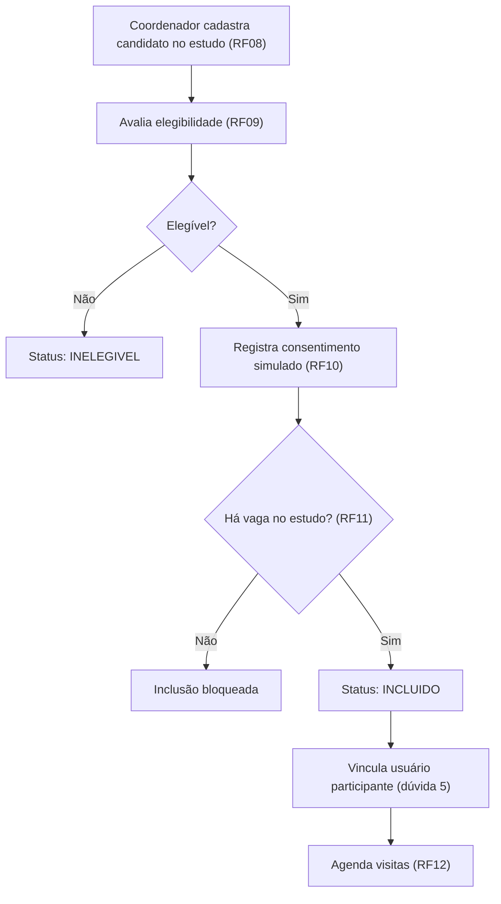
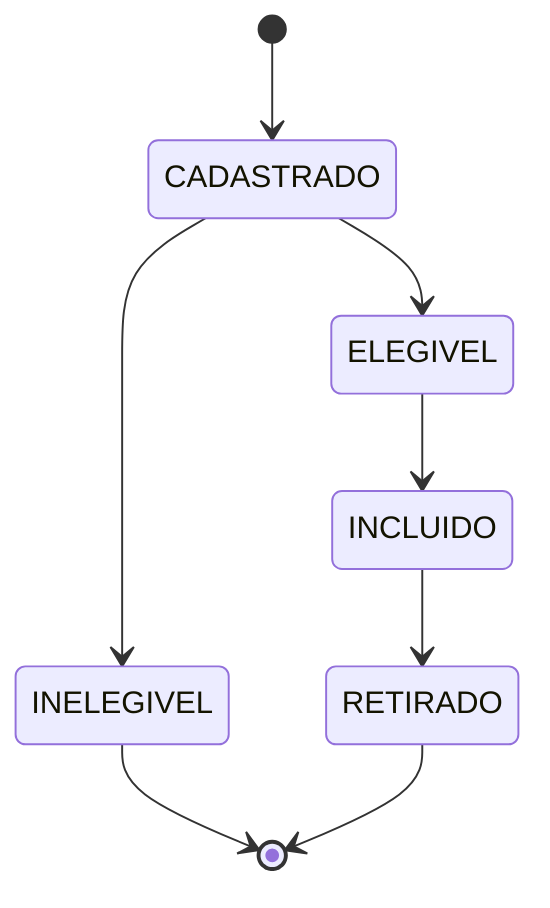
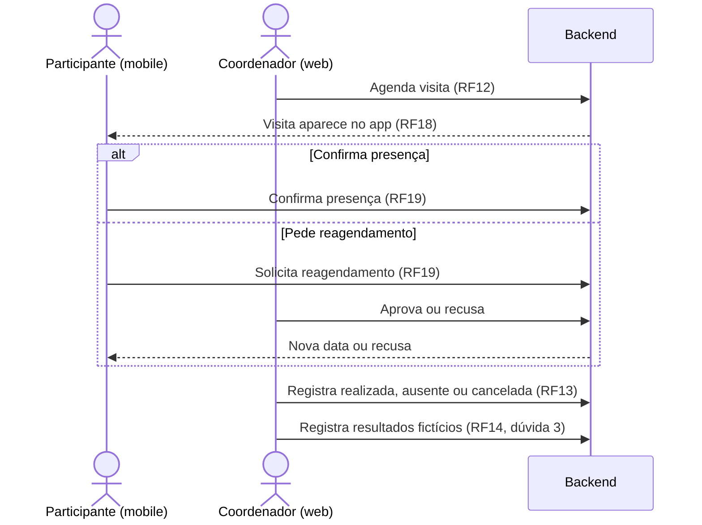
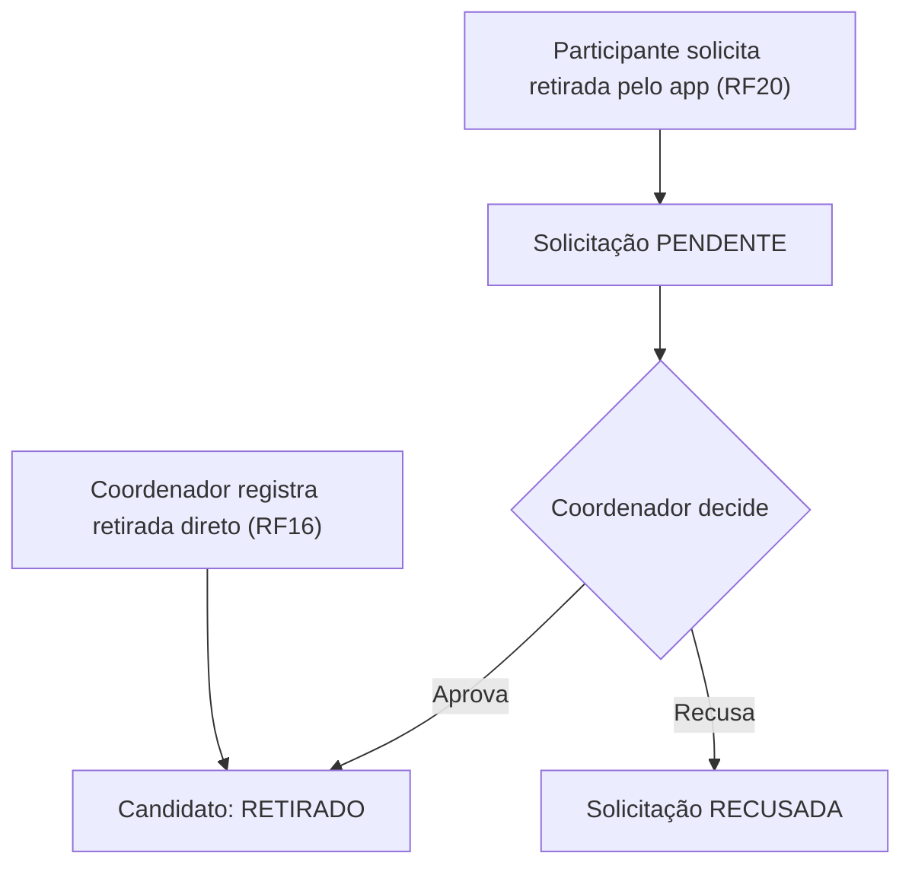

---
tags:
  - clinicalstudypb
  - eng-sw-2
  - mer
  - duvidas
  - sprint-1
atualizado: 2026-10-24
status: Em revisão
---

# ClinicalStudyPB: dúvidas e decisões do MER

> [!info] Objetivo
> Reunir em um só lugar as dúvidas para a professora, as decisões já tomadas na modelagem, o espaço para o MER e os fluxos principais de informação. O que ainda está em aberto fica marcado para ser fechado depois da conversa com a professora.

Documento de contexto: 

---

## 1. Dúvidas para a professora

> [!question] Como usar
> Preencher o campo **Resposta** durante ou depois da conversa.

### 1. Critérios (RF05)
O critério é um texto livre por estudo ou uma lista pré-definida que o pesquisador marca? Há necessidade de tabela?

**Resposta:** _a preencher_

### 2. Elegibilidade (RF09)
Basta registrar um resultado final (elegível sim/não, com observação) ou é preciso registrar critério por critério?

**Resposta:** _a preencher_

### 3. Avaliações (RF14)
A avaliação sempre ocorre dentro de uma visita, ou pode existir sozinha? "Avaliações previstas" são as atividades da visita (RF06)?

**Resposta:** _a preencher_

### 4. Visitas e turmas
As visitas são sempre individuais (por participante) ou pode haver visitas em grupo, com uma turma de participantes e uma equipe de pesquisadores e coordenador?

**Resposta:** _a preencher_

### 5. Contas de participante (RF01)
O admin cria a conta antes da inclusão, ou o sistema cria automaticamente quando o candidato é incluído (RF11)?

**Resposta:** _a preencher_

### 6. Candidato em vários estudos
Pode ser candidato em mais de um estudo ao mesmo tempo?

**Resposta:** _a preencher_

---

## 2. Decisões tomadas

| Decisão | Situação |
|---|---|
| A tabela `Candidato` registra os candidatos avaliados para entrar em um estudo, com `estudo_id` e `status` | Decidido |
| Após a elegibilidade e a inclusão, o candidato passa a ser um usuário (`usuario_id` opcional no candidato) | Decidido |
| Se a pessoa já tem usuário (aceita em outro estudo), reaproveita o mesmo id, sem criar outro | Decidido |
| Quem tem visita é o participante (usuário), não o candidato | Decidido |
| Solicitação de reagendamento e solicitação de retirada ficam em tabelas separadas | Decidido |
| Entidade `Avaliações` mantida como está no diagrama atual | Decidido |
| Equipe do estudo (pesquisadores e coordenador) como tabela de vínculo com o estudo | Sugerido, a confirmar |
| Turma (agrupar participantes) e visita ligada à turma | Aguarda a dúvida 4 |
| Separar `visita_prevista` (molde do protocolo, RF06) de `visita` (agendamento real) | Sugerido, a confirmar |
| Conta do participante criada pelo admin ou pelo sistema | Aguarda a dúvida 5 |

---

## 3. MER


![[CrinicalStudy.drawio.png]]

```mermaid
erDiagram
    %% colar aqui o erDiagram quando estiver fechado
```

---

## 4. Fluxos principais de informação

### 4.1 Recrutamento até a inclusão



### 4.2 Estados do candidato (proposta)



### 4.3 Visita, confirmação e reagendamento



### 4.4 Retirada do participante



---

## 5. Situação das entidades e o que ficou em aberto

| Entidade | Situação | Observação |
|---|---|---|
| `Usuario`, `Perfil`, `Permissao` | Existe no diagrama | Revisar cardinalidades e atributos (`senha_hash`, `ativo`, e-mail único) |
| `Estudo` | Existe, sem atributos | Incluir os atributos do RF04 e o estado do RF07 |
| `Candidato` | Existe, sem atributos | `estudo_id`, `status`, `usuario_id` opcional, dados de contato |
| `Criterio` (RF05) | Falta | Depende da dúvida 1 |
| Avaliação de elegibilidade (RF09) | Falta | Depende da dúvida 2 |
| Consentimento (RF10) | Falta | Pode ser colunas no `Candidato` ou tabela própria |
| `visita_prevista` e `atividade` (RF06) | Falta | A confirmar |
| `Visita` | Existe, incompleta | Ligar ao participante (usuário) e à visita prevista |
| `Avaliações` | Existe | Mantida; depende da dúvida 3 |
| Solicitação de reagendamento | Falta | Rascunho abaixo |
| Solicitação de retirada | Falta | Rascunho abaixo |
| Equipe / Turma | Falta | Depende da dúvida 4 |
| Auditoria | Falta | Backlog; nenhum RF exige hoje |

### Rascunho das tabelas de solicitações (a revisar)

**`solicitacao_reagendamento`**

| Campo | Observação |
|---|---|
| `id` | |
| `visita_id` | Chega ao participante pela visita |
| `nova_data_sugerida` | |
| `motivo` | |
| `status` | PENDENTE, APROVADA, RECUSADA |
| `decidido_por` | Usuário coordenador |
| `decidido_em` | |

**`solicitacao_retirada`**

| Campo | Observação |
|---|---|
| `id` | |
| `participante_id` | FK para `usuario` |
| `estudo_id` | |
| `motivo` | |
| `status` | PENDENTE, APROVADA, RECUSADA |
| `decidido_por` | Usuário coordenador |
| `decidido_em` | |

> [!warning] Regra a validar no backend
> Com a visita ligada ao usuário, o banco não impede agendar visita para quem não foi incluído no estudo. A service deve conferir se existe um `Candidato` com esse `usuario_id`, o `estudo_id` correspondente e status INCLUIDO.

### Pendências

- [ ] Fechar as dúvidas 1 a 6 com a professora
- [ ] Revisar cardinalidades `Usuario`–`Perfil` (um perfil por usuário?) e `Perfil`–`Permissao` (N:M)
- [ ] Definir os atributos de `Estudo` e `Candidato`
- [ ] Decidir entre consentimento em colunas ou tabela própria
- [ ] Decidir se haverá tabela de participação (garantia no banco) ou validação na service
- [ ] Padronizar a notação de cardinalidade no MER
- [ ] Montar o MER final e colar na seção 3
- [ ] Criar a migração `V1__criar_tabelas.sql` apenas com o necessário para RF01 a RF04
