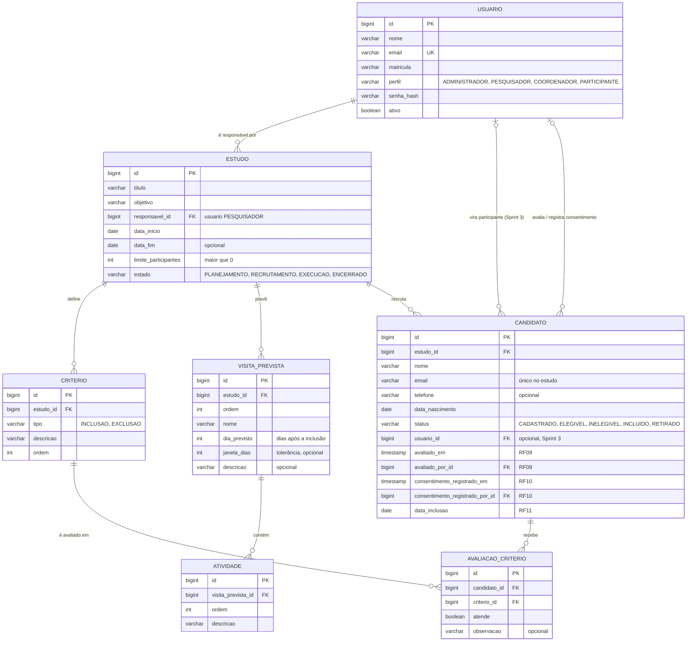
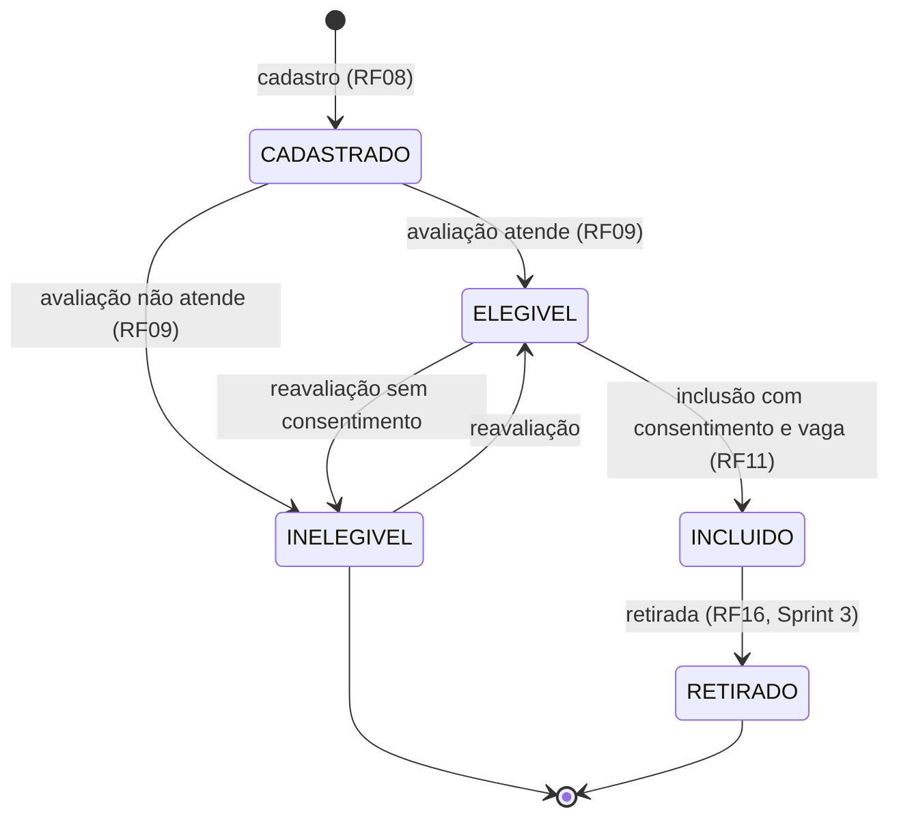

---
tags:
  - clinicalstudypb
  - eng-sw-2
  - mer
  - sprint-2
atualizado: 2026-11-04
status: Em revisão
substitui: "[[MER-v1]]"
---

# ClinicalStudyPB: MER/DER da Sprint 2 (RF05 a RF11)

> [!NOTE]
> Este documento continua o [[MER-v1]] (Sprint 1) e é a **base das migrações e dos endpoints** de RF05 a RF11: critérios, visitas previstas e atividades, candidatos, avaliação de elegibilidade, consentimento e inclusão. Tabelas já criadas (`usuario`, `estudo`, `candidato`) aparecem como estão nas migrações. O que ainda não foi implementado é a proposta que cada task deve seguir; mudanças devem ser registradas aqui antes de virar migração.

---

## 1. Decisões da Sprint 2

As dúvidas do MER-v1 que afetam RF05 a RF11 foram fechadas assim (as que dependem da professora ficam como **premissa**, revisável):

| # | Tema | Decisão | Situação |
|---|---|---|---|
| 1 | Critérios (RF05) | Lista de critérios por estudo, cada um do tipo INCLUSAO ou EXCLUSAO, com descrição livre | Premissa |
| 2 | Elegibilidade (RF09) | Avaliação **critério por critério**: para cada critério, "atende" (sim/não) e observação. O sistema calcula o resultado | Premissa (task 3560) |
| 3 | Resultado da avaliação | Elegível se atende **todos** os critérios de inclusão e **nenhum** de exclusão. Todos os critérios do estudo precisam ser avaliados | Decidido |
| 4 | Consentimento (RF10) | Colunas no `candidato` (quando e por quem foi registrado), não tabela própria: é um único registro por candidato | Decidido |
| 5 | Inclusão (RF11) | Coluna `data_inclusao` no `candidato`; vagas ocupadas = candidatos INCLUIDO do estudo | Decidido |
| 6 | Candidato em vários estudos | Permitido: o e-mail é único **dentro do estudo**, não no sistema | Decidido (task 3558) |
| 7 | Visita prevista × visita | `visita_prevista` é o molde do protocolo (RF06). A `visita` agendada (RF12) entra na Sprint 3 e aponta para ela | Decidido |
| 8 | Conta do participante | `candidato.usuario_id` fica vazio até a Sprint 3 decidir como a conta é criada | Aguarda dúvida 5 do MER-v1 |

---

## 2. Diagrama

Todas as tabelas também têm `criado_em` e `atualizado_em` (omitidos no diagrama).

---

## 3. Dicionário de dados

Tipos em PostgreSQL. **PK** chave primária, **FK** chave estrangeira, **UK** única.

### 3.1 `criterio` (RF05, task 3550)

| Coluna | Tipo | Nulo | Regra |
|---|---|---|---|
| `id` | BIGSERIAL | não | PK |
| `estudo_id` | BIGINT | não | FK `estudo(id)` |
| `tipo` | VARCHAR(10) | não | CHECK `INCLUSAO` ou `EXCLUSAO` |
| `descricao` | VARCHAR(500) | não | texto livre, mínimo 3 caracteres |
| `ordem` | INTEGER | não | > 0; UK (`estudo_id`, `tipo`, `ordem`) |

### 3.2 `visita_prevista` e `atividade` (RF06, task 3552)

| Coluna | Tipo | Nulo | Regra |
|---|---|---|---|
| `id` | BIGSERIAL | não | PK |
| `estudo_id` | BIGINT | não | FK `estudo(id)` |
| `ordem` | INTEGER | não | > 0; UK (`estudo_id`, `ordem`) |
| `nome` | VARCHAR(120) | não | ex.: "Visita de triagem" |
| `dia_previsto` | INTEGER | não | ≥ 0, dias contados da inclusão |
| `janela_dias` | INTEGER | sim | ≥ 0, tolerância para mais ou para menos |
| `descricao` | VARCHAR(500) | sim | |

| Coluna (`atividade`) | Tipo | Nulo | Regra |
|---|---|---|---|
| `id` | BIGSERIAL | não | PK |
| `visita_prevista_id` | BIGINT | não | FK `visita_prevista(id)` ON DELETE CASCADE |
| `ordem` | INTEGER | não | > 0; UK (`visita_prevista_id`, `ordem`) |
| `descricao` | VARCHAR(500) | não | ex.: "Coleta de sangue" |

### 3.3 `candidato` (RF08 a RF11, tasks 3558, 3560, 3563, 3565)

Colunas da migração V4 (já existentes): `id`, `estudo_id`, `nome`, `email`, `telefone`, `data_nascimento`, `status`, `usuario_id`. E-mail único por estudo: índice UK (`estudo_id`, `LOWER(email)`).

Colunas novas desta sprint:

| Coluna | Tipo | Nulo | Preenchida quando |
|---|---|---|---|
| `avaliado_em` | TIMESTAMP | sim | a avaliação de elegibilidade é registrada (RF09) |
| `avaliado_por_id` | BIGINT | sim | FK `usuario(id)`, quem avaliou |
| `consentimento_registrado_em` | TIMESTAMP | sim | o consentimento simulado é registrado (RF10) |
| `consentimento_registrado_por_id` | BIGINT | sim | FK `usuario(id)`, quem registrou |
| `data_inclusao` | DATE | sim | o candidato é incluído (RF11) |

### 3.4 `avaliacao_criterio` (RF09, task 3560)

| Coluna | Tipo | Nulo | Regra |
|---|---|---|---|
| `id` | BIGSERIAL | não | PK |
| `candidato_id` | BIGINT | não | FK `candidato(id)` ON DELETE CASCADE |
| `criterio_id` | BIGINT | não | FK `criterio(id)`; UK (`candidato_id`, `criterio_id`) |
| `atende` | BOOLEAN | não | para exclusão, `true` significa que o candidato **tem** a condição que exclui |
| `observacao` | VARCHAR(500) | sim | |

---

## 4. Regras de negócio por requisito

| RF | Regra | Onde fica |
|---|---|---|
| RF05 | Critérios só pertencem a um estudo; cada estudo precisa de pelo menos um critério de inclusão para avaliar candidatos | service de critério / avaliação |
| RF05 | Critério já usado em uma avaliação não pode ser excluído (FK de `avaliacao_criterio`) | banco |
| RF06 | Ordem das visitas e das atividades sem repetição; `dia_previsto` ≥ 0 | banco + service |
| RF07 | Estados: PLANEJAMENTO → RECRUTAMENTO → EXECUCAO → ENCERRADO (transições válidas na task 3554) | service de estudo |
| RF08 | Candidato só é cadastrado com o estudo em RECRUTAMENTO; e-mail único no estudo | service + banco |
| RF09 | Todos os critérios do estudo devem ser avaliados; resultado ELEGIVEL ou INELEGIVEL; grava quem avaliou e quando | service de avaliação |
| RF09 | A avaliação pode ser refeita enquanto o candidato não tiver consentimento registrado; refazer substitui as respostas anteriores | service de avaliação |
| RF10 | Consentimento só para candidato ELEGIVEL e sem consentimento anterior; grava quem registrou e quando | service de consentimento |
| RF11 | Inclusão valida, nesta ordem: estudo em RECRUTAMENTO, candidato ELEGIVEL, consentimento registrado, vaga disponível (incluídos < limite) | service de inclusão |
| RF11 | Ao incluir: status INCLUIDO e `data_inclusao` = hoje; a resposta traz vagas ocupadas e o limite | service de inclusão |

### Estados do candidato

---

## 5. Endpoints previstos

Prefixo `/api`. Perfis conforme a especificação e as tasks.

| Método e rota | RF | Perfil | Task |
|---|---|---|---|
| `GET/POST /estudos/{id}/criterios`, `PUT/DELETE /estudos/{id}/criterios/{criterioId}` | RF05 | PESQUISADOR (consulta também COORDENADOR) | 3550 |
| `GET/POST /estudos/{id}/visitas-previstas`, `PUT/DELETE .../{visitaId}` (com as atividades) | RF06 | PESQUISADOR | 3552 |
| `PATCH /estudos/{id}/estado` | RF07 | PESQUISADOR | 3554 |
| `GET/POST /estudos/{id}/candidatos`, `GET/PUT /estudos/{id}/candidatos/{candidatoId}` | RF08 | COORDENADOR | 3558 ✅ |
| `PUT /candidatos/{id}/avaliacao` (lista de `{criterioId, atende, observacao}`), `GET` para consultar | RF09 | COORDENADOR | 3560 |
| `POST /candidatos/{id}/consentimento` | RF10 | COORDENADOR | 3563 |
| `POST /candidatos/{id}/inclusao` → `{vagasOcupadas, limiteParticipantes}` | RF11 | COORDENADOR | 3565 |

As rotas de consentimento e inclusão são as que o front já chama (`candidatosService.ts`).

---

## 6. Migrações

O Flyway aplica em ordem e não aceita dois arquivos com o mesmo número. Cada task usa o número reservado abaixo; se precisar de outro, atualize esta tabela no mesmo PR.

| Versão | Conteúdo | Task | Situação |
|---|---|---|---|
| V1 | `usuario` | 3116 | Na develop |
| V2 | usuários de demonstração | 3116 | Na develop |
| V3 | `estudo` | 3238 | Na develop |
| V4 | `candidato` | 3558 | PR aberto |
| V5 | `criterio` | 3550 | Reservada |
| V6 | `visita_prevista` e `atividade` | 3552 | Implementada |
| V7 | `avaliacao_criterio` + `candidato.avaliado_em/avaliado_por_id` | 3560 | Reservada |
| V8 | `candidato.consentimento_*` | 3563 | Reservada |
| V9 | `candidato.data_inclusao` | 3565 | Reservada |

> [!WARNING]
> Se uma migração de número maior entrar na develop antes de uma de número menor, o Flyway recusa a menor nos bancos que já rodaram a maior. Nesse caso, recrie o banco local com `docker compose down -v` e suba de novo.

---

## 7. Fora desta sprint

`visita` (agendamento real, RF12–RF13), resultados de avaliações (RF14), solicitações de reagendamento e de retirada (RF19–RF20) e a conta do participante seguem o rascunho do [[MER-v1]] e entram no MER da Sprint 3.
