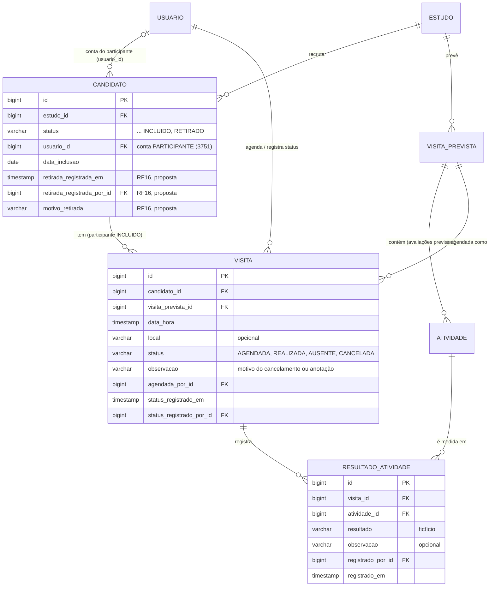
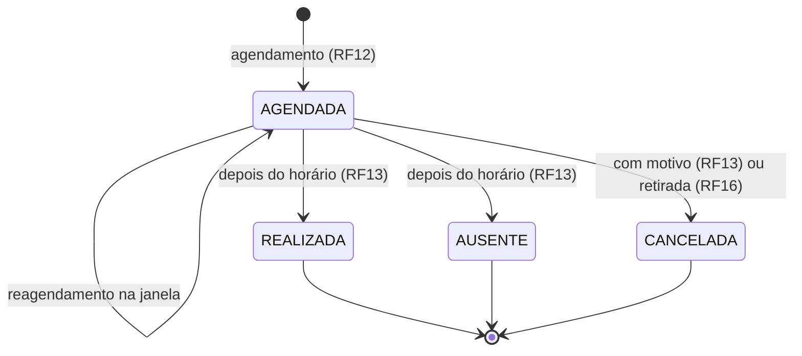

---
tags:
  - clinicalstudypb
  - eng-sw-2
  - mer
  - sprint-3
atualizado: 2026-11-21
status: Revisado (T-82, Azure 3748)
task: T-81 (Azure 3746)
continua: "MER-v2.md"
---

# ClinicalStudyPB: MER/DER da Sprint 3 (RF12 a RF18)

> [!NOTE]
> Continua o [MER-v2](MER-v2.md) (RF05 a RF11). Cobre a Release 2: conta do participante, agendamento e status das visitas, resultados fictícios, histórico, retirada e o app do participante. O que já está na `develop` (PR #54) aparece como **Implementado**. O resto é a **proposta** que cada task deve seguir. Mude este documento antes de criar uma migração diferente.

> [!WARNING]
> **Premissas**
> As dúvidas 3, 4 e 5 do [MER-v1](MER-v1.md) (avaliações, visitas em grupo e conta do participante) continuam sem resposta registrada no repositório (T-79). As decisões abaixo marcadas como **Premissa** podem mudar se a professora responder diferente.

---

## 1. Decisões da Sprint 3

| # | Tema | Decisão | Situação |
|---|---|---|---|
| 1 | Conta do participante (RF01/RF11) | A inclusão cria a conta `PARTICIPANTE` com o e-mail do candidato e grava `candidato.usuario_id`. A senha provisória volta uma única vez na resposta da inclusão. Se o e-mail já tem conta de participante (outro estudo), a conta é reaproveitada. E-mail de alguém da equipe bloqueia a inclusão | Implementado (3751). Premissa da dúvida 5 |
| 2 | Quem tem a visita | A `visita` aponta para o **candidato INCLUIDO** (participação em um estudo), não direto para o usuário. A conta chega às visitas por `candidato.usuario_id` | Implementado (3755) |
| 3 | Visitas individuais | Uma visita é de um participante. Visita em grupo (turma) fica fora | Premissa da dúvida 4 |
| 4 | Data da visita | A data precisa ficar entre `data_inclusao + dia_previsto - janela_dias` e `data_inclusao + dia_previsto + janela_dias`. Sem janela, só vale o próprio dia | Implementado (3755) |
| 5 | Status da visita (RF13) | AGENDADA → REALIZADA, AUSENTE ou CANCELADA. Os três são finais. Realizada e ausente só depois do horário marcado. O cancelamento exige o motivo. Uma visita cancelada libera um novo agendamento da mesma visita prevista | Implementado (3758) |
| 6 | Avaliações previstas (RF14) | As "avaliações previstas" são as `atividade` da visita prevista (RF06). O resultado fictício é registrado por atividade, só em visita REALIZADA | Proposta (3763). Premissa da dúvida 3 |
| 7 | Histórico (RF15) | Consulta, sem tabela nova: visitas do participante com os resultados, em ordem de data | Proposta (3765) |
| 8 | Retirada (RF16) | Colunas no `candidato` (quando, por quem e motivo), como foi feito no consentimento. Status vai para RETIRADO. As visitas AGENDADAS daquele participante viram CANCELADA com o motivo "Retirada do participante" | Proposta (3768) |
| 9 | Conta depois da retirada | A conta continua ativa: o app lista as participações INCLUIDO e RETIRADO (RF17), e o participante segue vendo o próprio histórico. Desativar a conta fica com o administrador (RF01), e uma conta desativada não é reativada sozinha numa nova inclusão (3751) | Proposta (3768) |
| 10 | App do participante (RF17/RF18) | `/participantes/me/estudos` e `/participantes/me/visitas` usam o `sub` do token: participações com `candidato.usuario_id` = usuário logado. O participante nunca informa ids de outra pessoa | Proposta (3773, 3775) |
| 11 | Solicitações (RF19/RF20) | Confirmar presença, pedir reagendamento e pedir retirada pelo app ficam fora da Sprint 3, mesmo aparecendo nos tipos do mobile | Fora da sprint |

---

## 2. Diagrama

Só as tabelas novas ou alteradas na Sprint 3. As demais estão no [MER-v2](MER-v2.md).

Todas as tabelas também têm `criado_em` e `atualizado_em` (omitidos no diagrama).

---

## 3. Dicionário de dados

### 3.1 `visita` (RF12/RF13, tasks 3755 e 3758): implementado na V11

| Coluna | Tipo | Nulo | Regra |
|---|---|---|---|
| `candidato_id` | BIGINT FK `candidato` | não | Candidato com status INCLUIDO no momento do agendamento |
| `visita_prevista_id` | BIGINT FK `visita_prevista` | não | Do mesmo estudo do candidato |
| `data_hora` | TIMESTAMP | não | Dentro da janela (decisão 4) |
| `local` | VARCHAR(120) | sim | |
| `status` | VARCHAR(20) | não | CHECK nos 4 valores; padrão AGENDADA |
| `observacao` | VARCHAR(500) | sim | Obrigatória no cancelamento (validado na service) |
| `agendada_por_id` | BIGINT FK `usuario` | não | Coordenador que agendou |
| `status_registrado_em` / `status_registrado_por_id` | TIMESTAMP / BIGINT FK | sim | Preenchidos ao sair de AGENDADA |

Índices: único parcial `(candidato_id, visita_prevista_id) WHERE status <> 'CANCELADA'`; `(candidato_id, data_hora)`; `(visita_prevista_id)`. A V11 também cria `ix_candidato_usuario` em `candidato (usuario_id)` para o app.

Visita prevista com agendamentos não pode ser excluída (409 `VISITA_PREVISTA_COM_AGENDAMENTOS`). Visita prevista com resultados registrados não pode ser editada (409 `VISITA_PREVISTA_COM_RESULTADOS`), porque a edição recria as atividades.

### 3.2 `resultado_atividade` (RF14, task 3763): proposta para a V12

| Coluna | Tipo | Nulo | Regra |
|---|---|---|---|
| `visita_id` | BIGINT FK `visita` | não | Visita com status REALIZADA |
| `atividade_id` | BIGINT FK `atividade` | não | Atividade da mesma visita prevista da visita |
| `resultado` | VARCHAR(500) | não | Texto livre fictício (ex.: "PA 120x80") |
| `observacao` | VARCHAR(500) | sim | |
| `registrado_por_id` | BIGINT FK `usuario` | não | Quem registrou ou alterou por último |
| `registrado_em` | TIMESTAMP | não | Quando registrou ou alterou por último |

Único: `(visita_id, atividade_id)`. O PUT grava em lote: registrar de novo a mesma atividade substitui o resultado (upsert). A FK de `atividade_id` fica sem `ON DELETE CASCADE`: atividade com resultado não pode ser apagada. A visita prevista com agendamento não pode ser excluída (`VISITA_PREVISTA_COM_AGENDAMENTOS`), e a que tem resultado não pode ser editada (`VISITA_PREVISTA_COM_RESULTADOS`), porque a edição apaga e recria as atividades.

### 3.3 `candidato`: retirada (RF16, task 3768): proposta para a V13

| Coluna | Tipo | Nulo | Regra |
|---|---|---|---|
| `retirada_registrada_em` | TIMESTAMP | sim | Preenchida quando o status vira RETIRADO |
| `retirada_registrada_por_id` | BIGINT FK `usuario` | sim | Coordenador que registrou |
| `motivo_retirada` | VARCHAR(500) | sim | Obrigatório na retirada (validado na service) |

Os nomes seguem o padrão do consentimento (`consentimento_registrado_em` e `consentimento_registrado_por_id`, V8). O CHECK `ck_candidato_status` da V4 já aceita RETIRADO, então a V13 não precisa alterá-lo.

O seed (V10) já tem um candidato RETIRADO sem esses dados (estudo do sono). A V13 preenche os RETIRADO existentes com `retirada_registrada_em = atualizado_em` e o motivo "Retirada registrada antes do RF16 (dados de demonstração)", para o histórico e o app não mostrarem a retirada sem data.

---

## 4. Regras de negócio por requisito

| RF | Regra | Onde fica | Situação |
|---|---|---|---|
| RF11 | A inclusão cria ou reaproveita a conta do participante na mesma transação. Se a conta falhar, nada é gravado | `InclusaoService` + `ContaParticipanteService` | Implementado |
| RF12 | Só participante INCLUIDO, estudo não encerrado, visita prevista do mesmo estudo, data na janela e sem outro agendamento ativo da mesma visita prevista | `VisitaService` | Implementado |
| RF12 | O reagendamento só vale para visita AGENDADA, com a mesma janela | `VisitaService` | Implementado |
| RF13 | Transições e regras da decisão 5. Estudo encerrado bloqueia | `VisitaService` | Implementado |
| RF14 | Resultado só em visita REALIZADA (`VISITA_NAO_REALIZADA`), para atividades da visita prevista correspondente (`ATIVIDADE_FORA_DA_VISITA`). Resultado obrigatório, até 500 caracteres. Estudo encerrado bloqueia (`ESTUDO_ENCERRADO`) | `ResultadoService` | Proposta |
| RF15 | Histórico = visitas (todas as situações) + resultados, por data; consulta do coordenador e do pesquisador | service de histórico | Proposta |
| RF16 | Retirada só de participante INCLUIDO (`PARTICIPANTE_NAO_INCLUIDO`; se já retirado, `PARTICIPANTE_JA_RETIRADO`); motivo obrigatório, até 500 caracteres; na mesma transação, cancela as visitas AGENDADAS (REALIZADA, AUSENTE e CANCELADA não mudam); a vaga é liberada porque a contagem usa só INCLUIDO; decisão 9 para a conta | `RetiradaService` | Proposta |
| RF17 | O app lista as participações do usuário logado (INCLUIDO e RETIRADO) com o estudo | `/participantes/me/estudos` | Proposta |
| RF18 | O app lista as visitas das participações do usuário logado: próximas (AGENDADA, data futura) e histórico de comparecimento (REALIZADA, AUSENTE) | `/participantes/me/visitas` | Proposta |

Códigos de erro novos da Sprint 3, além dos que já existem (`PARTICIPANTE_NAO_INCLUIDO`, `ESTUDO_ENCERRADO`, `VISITA_JA_AGENDADA`, `VISITA_JA_FINALIZADA`, `VISITA_AINDA_NAO_OCORREU`): `VISITA_NAO_REALIZADA`, `ATIVIDADE_FORA_DA_VISITA`, `VISITA_PREVISTA_COM_RESULTADOS` e `PARTICIPANTE_JA_RETIRADO`. Todos respondem 409, no mesmo formato do `RegraNegocioException`.

### Estados da visita

---

## 5. Endpoints

Prefixo `/api`.

| Método e rota | RF | Perfil | Task | Situação |
|---|---|---|---|---|
| `POST /candidatos/{id}/inclusao` → `{vagasOcupadas, limiteParticipantes, conta}` | RF11 | COORDENADOR | 3751 | Implementado |
| `GET /candidatos/{id}/conta`, `POST /candidatos/{id}/conta/senha-provisoria` | RF01 | COORDENADOR | 3751 | Implementado |
| `GET/POST /candidatos/{id}/visitas` | RF12 | COORDENADOR | 3755 | Implementado |
| `GET /estudos/{id}/visitas?status&de&ate` | RF12 | PESQUISADOR, COORDENADOR, ADMINISTRADOR | 3755 | Implementado |
| `GET/PUT /visitas/{id}` | RF12 | COORDENADOR | 3755 | Implementado |
| `PATCH /visitas/{id}/status` | RF13 | COORDENADOR | 3758 | Implementado |
| `PUT /visitas/{id}/resultados` (`{itens: [{atividadeId, resultado, observacao}]}`) | RF14 | COORDENADOR | 3763 | Proposta |
| `GET /visitas/{id}/resultados` (todas as atividades, com o resultado ou vazio) | RF14 | PESQUISADOR, COORDENADOR, ADMINISTRADOR | 3763 | Proposta |
| `GET /candidatos/{id}/historico` | RF15 | COORDENADOR, PESQUISADOR | 3765 | Proposta |
| `POST /candidatos/{id}/retirada` (`{motivo}`) → candidato, visitas canceladas e vagas ocupadas/total | RF16 | COORDENADOR | 3768 | Proposta |
| `GET /participantes/me/estudos` | RF17 | PARTICIPANTE | 3773 | Proposta |
| `GET /participantes/me/visitas` | RF18 | PARTICIPANTE | 3775 | Proposta |

O `GET /visitas/{id}/resultados` precisa de uma regra no `SecurityConfig` antes de `/visitas/**`, que hoje é só do coordenador.

O contrato das rotas implementadas está em [`openapi.yaml`](../api/openapi.yaml).

---

## 6. Migrações

Continua a tabela do [MER-v2](MER-v2.md) (seção 6). Cada task usa o número reservado. Se precisar de outro, atualize esta tabela no mesmo PR.

| Versão | Conteúdo | Task | Situação |
|---|---|---|---|
| V10 | seed de demonstração | 3542 | Na develop |
| V11 | `visita` + índice `candidato.usuario_id` | 3755 / 3758 | Na develop |
| V12 | `V12__criar_resultado_atividade.sql` | 3763 | Reservada |
| V13 | `V13__adicionar_retirada_candidato.sql` (`retirada_registrada_em`, `retirada_registrada_por_id`, `motivo_retirada`) | 3768 | Reservada |
| V14 | seed da Release 2 (participantes com conta, visitas e resultados) | 3750 | Reservada |

A conta do participante (3751) não precisou de migração: `candidato.usuario_id` já existia desde a V4.
