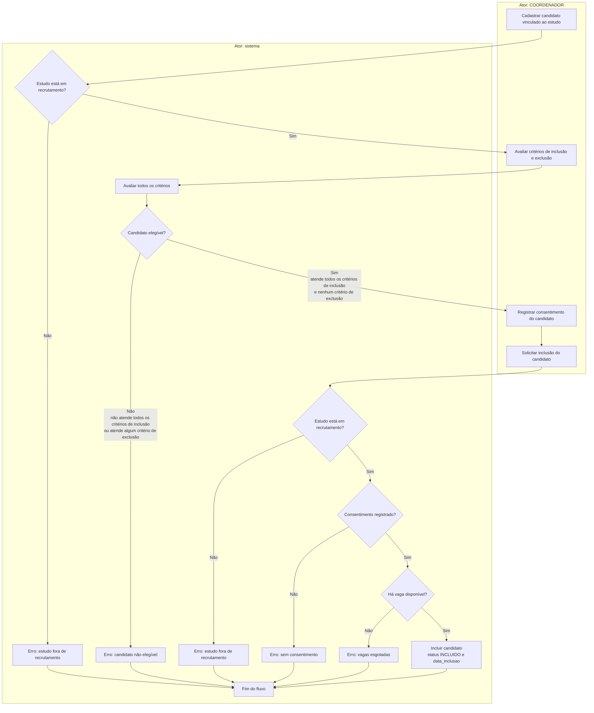

# ClinicalStudyPB: fluxo de recrutamento

O candidato é cadastrado pelo COORDENADOR quando o estudo está em recrutamento. O sistema avalia todos os critérios configurados, considerando elegível quem atende a todos os critérios de inclusão e a nenhum critério de exclusão. Candidatos elegíveis seguem para o registro do consentimento e, depois, para a inclusão, que só ocorre com o estudo em recrutamento, com consentimento registrado e com vaga disponível.
