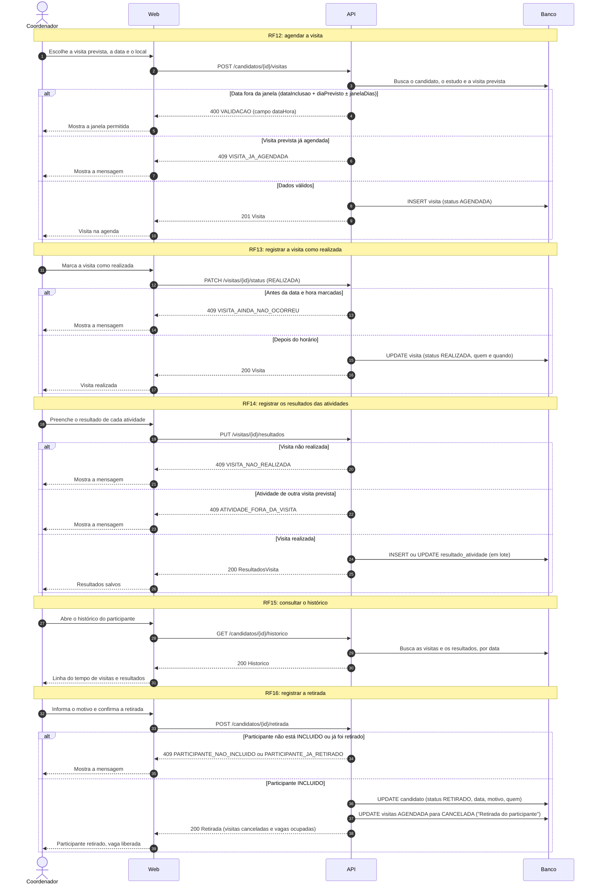
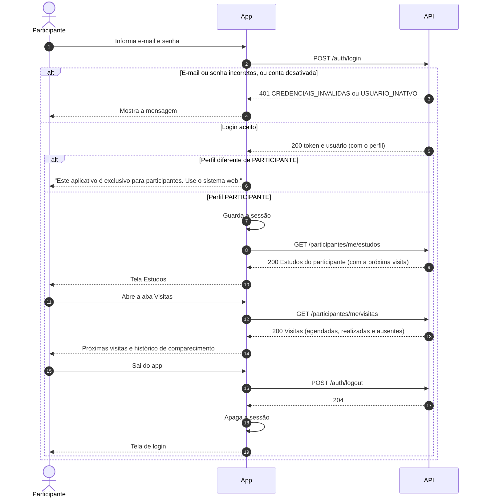

# ClinicalStudyPB: diagramas de sequência da Release 2

Os dois fluxos novos da Release 2. As rotas são as do [`openapi.yaml`](../api/openapi.yaml) (task 3749) e as tabelas são as do [MER-v3](MER-v3.md). Se uma rota mudar, este documento muda no mesmo PR.

Todas as chamadas, menos o login, levam o token no cabeçalho `Authorization: Bearer <token>`. Um perfil sem permissão recebe 403 `SEM_PERMISSAO` em qualquer rota (omitido nos diagramas).

## 1. Acompanhamento do participante na web (RF12 a RF16)

O coordenador agenda a visita, registra que ela foi realizada, registra os resultados das atividades, consulta o histórico e, por fim, registra a retirada do participante.

## 2. Login e consulta no app do participante (RF17 e RF18)

O participante entra no app com a conta criada na inclusão, consulta os estudos e as visitas e sai. O app só aceita o perfil PARTICIPANTE.

Se o token vencer durante o uso, qualquer rota responde 401 e o app volta para a tela de login.
