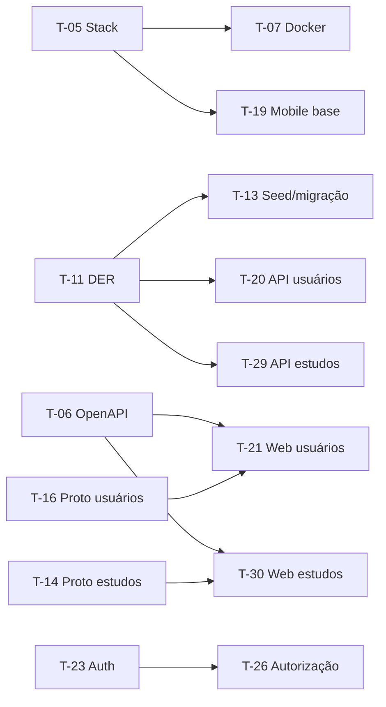

---
tags:
  - sprint
  - clinicalstudypb
  - eng-sw-2
sprint: 1
release: 1
inicio: 2026-10-13
fim: 2026-10-26
lider-da-sprint: Nidlan hendell
status: concluído
---

# Sprint 1 — ClinicalStudyPB

> [!info] Navegação
> Release 1 (Sprints 1 e 2) · Entrega em 09/11/2026 · Próxima: [[sprint-2]]

## 1. Contexto geral

- **Projeto:** ClinicalStudyPB, sistema simplificado de gestão do ciclo de vida de estudos clínicos (dados fictícios, sem decisão clínica automatizada).
- **Release 1 — Estrutura e recrutamento:** aplicação web funcional que permite cadastrar um estudo, avaliar candidatos e incluir participantes.
- **Objetivo da Sprint 1:** deixar a base pronta (repositório, ambiente, modelagem, protótipos) e entregar os requisitos **RF01 a RF04** (usuários, autenticação, autorização e cadastro de estudos).
- **Fora do escopo:** RF05 em diante (Sprint 2).
- **Rotação de papéis:** cada integrante assume um papel diferente a cada sprint. O papel define o foco, mas testes, documentação e revisão de código são **compartilhados** (exigência do projeto).

### Requisitos da sprint

| ID   | Requisito                                                                              |
| ---- | -------------------------------------------------------------------------------------- |
| RF01 | Cadastrar e gerenciar usuários (pesquisador, coordenador, administrador, participante) |
| RF02 | Autenticação e encerramento de sessão                                                  |
| RF03 | Restringir funcionalidades conforme o perfil                                           |
| RF04 | Cadastrar estudos (título, objetivo, responsável, datas, limite de participantes)      |

### Equipe e papéis nesta sprint

| #   | Papel                                                 | Responsável    | Foco                                             |
| --- | ----------------------------------------------------- | -------------- | ------------------------------------------------ |
| 1   | Líder técnico / Gerente                               | Nidlan Hendell | Organização, arquitetura, API, decisões técnicas |
| 2   | Desenvolvedor Backend                                 | Maria Eduarda  | Regras de negócio, persistência, testes          |
| 3   | Desenvolvedor Web (estudos, protocolos, usuários)     | Mirelle        | Telas de estudos                                 |
| 4   | Desenvolvedor Web (recrutamento, visitas, relatórios) | Adrielly       | Telas de usuários (nesta sprint)                 |
| 5   | Desenvolvedor Mobile                                  | Jasmine        | App do participante                              |
| 6   | QA / DevOps                                           | Arthur         | Ambiente, CI, qualidade                          |

## 2. Duração da sprint

- **Período:** 13/10/2026 a 26/10/2026 (14 dias, 10 dias úteis)
- **Planning:** 13/10
- **Checkpoint intermediário:** 19/10 
- **Review + Retrospectiva:** 26/10
- **Gerenciamento:** board e burndown no Azure DevOps

## 3. Backlog da sprint (Epic > User Story > Task)

> [!tip] Convenção
> `EP` = Epic · `US` = User Story · `T` = Task. Estimativas em horas (valores iniciais, a ajustar no planning). Responsável: número do papel (1 a 6).
> Itens marcados com 💡 foram **sugeridos** além do seu esboço, para cobrir o RF01–RF04 e as exigências do projeto. Podem ser cortados ou movidos.

### EP-01 — Fundação do projeto

**US-01.1** — Como equipe, quero repositório, board e decisões técnicas definidos para começar a desenvolver de forma organizada.

- [x] **T-01** Planejar a sprint: separar, organizar e distribuir as atividades (este documento) · 1 · 3h *(este documento, commit `39215c4`, 13/10)*
- [ ] **T-02** Diagrama de atividade do fluxo da sprint/do processo · 1 · 3h *(sem evidência no repositório; o diagrama de atividade existente é o do recrutamento, da Sprint 2)*
- [x] **T-03** 💡 Criar o board no Azure DevOps (PBIs, tasks, sprint, burndown) · 1 · 2h *(board e sprint no Azure DevOps; o burndown exportado está em `releases/burndown_sprint1.png`)*
- [x] **T-04** 💡 Criar repositório GitHub com README.md principal (esqueleto), `releases/release1/README.md`, política de branches e pull requests · 1 · 3h *(repositório com README e `realeases/release1/README.md` como esqueletos (commits `39215c4` e `9f35014`); a política de branches e PRs foi descrita no README principal na Sprint 2 (3581))*
- [x] **T-05** 💡 Decidir e justificar o stack (A, B ou C) e registrar no README · 1 · 3h *(Stack A (Spring Boot + React + React Native + PostgreSQL), registrada em `Contexto-Geral/Orientacoes/setup-projeto-v1.md`, commit `c77f867`)*
- [x] **T-06** 💡 Esboçar o contrato da API para RF01–RF04 · 1 · 4h *(`api/openapi.yaml` e `como-acessar-contrato-api.md`, commit `8b77dc3`, 24/10)*

**US-01.2** — Como equipe, quero um ambiente de desenvolvimento padronizado com Docker para que qualquer integrante (e a equipe da Release 3) rode o projeto igual.

- [x] **T-07** Criar `docker-compose` com banco PostgreSQL + backend + web · 6 · 6h *(Arthur, PRs #1 e #2 (task 3043), 23 a 24/10; ajustado pelo Nidlan em `49c28b9`)*
- [x] **T-08** Criar scripts/instruções de instalação e execução (seção do README) · 6 · 2h *(`DOCKER.md`, commit `49c28b9` (Nidlan), 26/10)*
(Opcional)
- [ ] **T-09** 💡 Configurar CI no GitHub Actions (build + testes a cada PR) · 6 · 5h *(não concluída na Sprint 1: o workflow entrou na Sprint 2 (tasks 3546 e 3575, commit `19007d7` de 04/11))*
- [x] **T-10** 💡 Configurar ferramentas de teste e cobertura (conforme stack) · 6 · 4h *(Arthur, PR #9 (task 3083): JUnit + JaCoCo no backend e Vitest com cobertura no frontend, 25/10)*

### EP-02 — Modelagem e protótipos

**US-02.1** — Como equipe, quero o modelo de dados definido para que backend e telas usem a mesma estrutura.

- [x] **T-11** MER/DER inicial (usuário/perfil, estudo; já prevendo candidato, critério, visita) · 2 · 6h *(`Diagramas/MER-v1.md`, commit `8b77dc3` (Nidlan), 24/10; as dúvidas com a professora ficaram para o MER-v2)*
- [ ] **T-12** Revisão do DER por outro integrante (revisão cruzada) · 1 · 1h *(sem evidência de revisão do DER no repositório)*

**US-02.2** — Como pesquisador, quero ver o fluxo de cadastro de estudos em um protótipo para validar a navegação antes de codificar.

- [ ] **T-14** Protótipo navegável: listagem, cadastro e edição de estudo (Figma/Penpot) · 3 · 8h *(link do Figma no README da Release 1; falta conferir se as telas de estudos estão lá)*
- [ ] **T-15** Incluir no protótipo estados de erro/validação (campos obrigatórios, datas inválidas, limite de participantes) · 3 · 2h *(falta conferir no Figma)*

**US-02.3** — Como administrador, quero ver o fluxo de cadastro de usuários em um protótipo para validar a navegação.

- [ ] **T-16** Protótipo navegável: login, listagem, cadastro e edição de usuário (com perfil) · 4 · 8h *(link do Figma no README da Release 1; falta conferir se as telas de usuários estão lá)*
- [ ] **T-17** Incluir no protótipo estados de erro (e-mail duplicado, senha inválida, acesso negado) · 4 · 2h *(falta conferir no Figma)*

**US-02.4** — Como participante, quero as telas essenciais no celular para acessar o app.

- [x] **T-18** Adaptar os protótipos para mobile: login e navegação base do participante · 5 · 8h *(Jasmine, commit `428b809` (navegação por abas e telas do participante, PR #6), 25/10)*

### EP-03 — Usuários, autenticação e autorização (RF01, RF02, RF03)

**US-03.1** — Como administrador, quero cadastrar e gerenciar usuários com perfis para controlar quem acessa o sistema. *(RF01)*

- [x] ==🟢**T-20** 💡 Backend: entidade Usuário/Perfil, regras (e-mail único, ativar/desativar) e endpoints CRUD · 2 · 10h== *(Maria Eduarda, PR #7 (AB#3116), 25/10)*
- [x] **T-21** 💡 Web: telas de cadastro, listagem e edição de usuários integradas à API · 4 · 10h *(Adrielly, PRs #11 e #12 (AB#3334), 25 a 26/10)*
- [x] **T-22** 💡 Testes unitários e de integração do cadastro de usuários · 2 e 4 · 4h *(`UsuarioServiceTest` e `UsuarioControllerTest` (Maria Eduarda, PR #7) e testes das telas de usuários e de login (Adrielly, PRs #10 e #11))*

**US-03.2** — Como usuário, quero entrar e sair do sistema para acessar minhas funcionalidades. *(RF02)*

- [x] ==🟢**T-23** 💡 Backend: autenticação (login, token/sessão, logout) · 2 · 8h== *(Maria Eduarda, PR #8 (AB#3218): login com JWT, logout e usuário logado, 25/10)*
- [x] **T-24** 💡 Web: tela de login e logout · 4 · 4h *(Adrielly, PRs #3 e #12 (AB#3219), 24 a 26/10)*
- [x] **T-25** 💡 Mobile: tela de login do participante (estrutura) · 5 · 5h *(Jasmine, commit `e2ca28c` (PR #6), 20/10)*

**US-03.3** — Como usuário, quero ver apenas o que meu perfil permite. *(RF03)*

- [x] **T-26** 💡 Backend: controle de acesso por perfil nos endpoints · 2 · 6h *(Maria Eduarda, PR #13 (AB#3221), 26/10)*
- [x] **T-27** 💡 Web: menus e rotas restritos por perfil · 3 · 5h *(Mirelle, PR #4 (task 3222): rotas protegidas, menu por perfil e tela de acesso negado, 24/10)*
- [x] **T-28** 💡 Testes de autorização (acesso permitido/negado por perfil) · 6 · 4h *(`AutorizacaoTest`, feito pela Maria Eduarda no PR #13 (AB#3221), 26/10)*

### EP-04 — Gestão de estudos (RF04)

**US-04.1** — Como pesquisador, quero cadastrar estudos com título, objetivo, responsável, datas e limite de participantes. *(RF04)*

- [x] ==🟢**T-29** 💡 Backend: entidade Estudo, validações (datas, limite > 0) e endpoints · 2 · 10h== *(Maria Eduarda, PR #14 (AB#3238), com `EstudoControllerTest`, 26/10)*
- [ ] **T-30** 💡 Web: telas de listagem, cadastro e edição de estudos integradas à API · 3 · 10h *(parcial: telas de listagem, cadastro e edição com dados fictícios (Mirelle, PR #5, task 3237). A integração com a API ficou para a Sprint 2 (task 3545))*
- [ ] **T-31** 💡 Testes unitários, de integração e de componente do cadastro de estudos · 2 e 3 · 5h *(movida para a Sprint 2 como pendência (task 3236, concluída em 06/11); na Sprint 1 só havia o `EstudoControllerTest` do backend)*

### Tarefas compartilhadas (todos)

- [x] **T-32** Revisão de código cruzada em todos os PRs (mínimo 1 revisor) · todos *(PRs #1 a #14 mesclados por um integrante diferente do autor)*
- [ ] **T-33** Documentação da sprint no `releases/release1/README.md` (parte de cada um) · todos *(não feita na Sprint 1: o README da release foi preenchido na Sprint 2)*
- [ ] **T-35** Preparar demonstração da sprint · todos *(sem evidência no repositório)*

## 4. Distribuição por membro

| #   | Papel           | Tasks principais                                               | Horas (aprox.) |
| --- | --------------- | -------------------------------------------------------------- | -------------- |
| 1   | Líder / Gerente | T-01 a T-06, T-12, ==🟢T-20==, T-23,==🟢T-29==                 | ~23h           |
| 2   | Backend         | T-11, ==🟢T-20, T-23==, T-26, ==🟢T-29== (+ testes T-22, T-31) | ~31h           |
| 3   | Web (estudos)   | T-14, T-15, T-27, T-30 (+ testes T-31)                         | ~22h           |
| 4   | Web (usuários)  | T-16, T-17, T-21, T-24 (+ testes T-22)                         | ~22h           |
| 5   | Mobile          | T-18, T-25                                                     | ~13h           |
| 6   | QA / DevOps     | T-07 a T-10, T-28, T-31, T-22                                  | ~30h           |

### Dependências críticas

**Atenção:** T-05 (stack) desbloqueia Docker e o projeto mobile; deve ser decidido nos primeiros dias.

## 5. Registro da sprint (preencher ao longo e no fim)

> [!note] Preenchimento posterior
> As partes de fatos desta seção (o que foi feito, o que falta, contribuição e situação dos requisitos) foram preenchidas em 17/11/2026 por Mirelle, a partir do histórico do repositório (commits e PRs #1 a #14). O que é avaliação do gerente da sprint (o que melhorar, impedimentos, ações e análise do burndown) fica para Nidlan Hendell.

### Review (26/10)

#### O que foi feito
- Base do projeto: repositório, Stack A (Spring Boot + React + React Native + PostgreSQL), Docker Compose com banco, backend e frontend (`DOCKER.md`), JUnit + JaCoCo e Vitest com cobertura.
- Modelagem: MER-v1 e contrato OpenAPI de RF01 a RF04.
- RF01: backend de usuários com e-mail único e ativação e desativação, telas web integradas à API e testes.
- RF02: login com JWT e logout no backend; tela de login integrada à API, com sessão salva.
- RF03: controle de acesso por perfil nos endpoints, com `AutorizacaoTest`, e rotas e menus restritos na web.
- RF04: backend de estudos com validações de datas e limite; telas de estudos com dados fictícios.
- Mobile: tela de login e navegação por abas do participante.

#### O que falta
- Integrar as telas de estudos à API (3237, feito na Sprint 2 como 3545).
- Testes de integração e de componente do cadastro de estudos (3236, feito na Sprint 2).
- CI no GitHub Actions (feito na Sprint 2: 3546 e 3575).
- Revisão cruzada do DER e diagrama de atividade da sprint (sem evidência).

#### O que melhorar
- 

#### Impedimentos encontrados
- 

#### Ações de melhoria para a [[sprint-2]]
- [ ] 

### Burndown

![[../../../releases/burndown_sprint1.png]]

**Análise (planejado x realizado):**

- **13/10 a 19/10, sem queda:** o restante começou em cerca de 121h e **subiu para cerca de 124h em 15/10**, porque tasks foram acrescentadas ou reestimadas depois do planning. Ficou parado até 19/10. Enquanto isso, a linha ideal já pedia cerca de 62h no checkpoint. No repositório, nesse período só há a estrutura da documentação (13/10).
- **20/10 a 23/10, queda lenta:** foi de cerca de 106h para cerca de 76h. O trabalho começou a andar com o login mobile (20/10), a estrutura do Spring Boot e do frontend e o Docker Compose (23/10). A distância para o ideal continuou grande: 76h contra cerca de 12h.
- **23/10 a 26/10, concentração no fim:** a maior queda da sprint, de cerca de 76h para **cerca de 12h**. Ela coincide com os PRs #1 a #14, todos abertos e mesclados entre 24/10 e 26/10: usuários, autenticação, autorização, estudos e testes.
- **Resultado:** a sprint fechou com **cerca de 12h restantes**, e não com 0h. Essas horas são as pendências que foram para a Sprint 2: integração das telas de estudos com a API (3237/3545), testes do cadastro de estudos (3236) e CI (3546). O valor 0 no topo do gráfico mostra o Remaining Work atual, zerado depois.
- **Leitura:** o real ficou acima do ideal durante toda a sprint, e quase toda a entrega aconteceu nos últimos 3 dias. As causas visíveis são a configuração do projeto (stack, Docker e estrutura) só ter ficado pronta em 23/10, o que travou backend e web, e o Remaining Work não ser atualizado todo dia. A Sprint 2 corrigiu parte disso: o burndown dela acompanhou melhor a linha ideal.

### Contribuição por integrante

| # | Papel | Contribuição na sprint |
|---|---|---|
| 1 | Líder | Nidlan Hendell: planejamento da sprint e estrutura do repositório e da documentação, guia de setup com a escolha da Stack A, MER-v1 e contrato OpenAPI de RF01 a RF04, estrutura inicial do Spring Boot e do frontend, `DOCKER.md` e ajustes no Docker Compose. Mesclou os PRs #1 a #14. |
| 2 | Backend | Maria Eduarda: backend de usuários e perfis (PR #7), autenticação com JWT e logout (PR #8), controle de acesso por perfil com `AutorizacaoTest` (PR #13) e backend de estudos com validações (PR #14), todos com testes unitários e de controller. |
| 3 | Web (estudos) | Mirelle: rotas protegidas, menu por perfil e tela de acesso negado (PR #4) e telas de listagem, cadastro e edição de estudos com dados fictícios (PR #5). |
| 4 | Web (usuários) | Adrielly: tela de login com validação e contexto de autenticação (PR #3), configuração do Vitest e Testing Library, telas de usuários (PR #11), integração do login e dos usuários com a API (PR #12) e testes das telas (PRs #10 e #11). |
| 5 | Mobile | Jasmine: tela de login do participante e navegação por abas com as telas do participante (PR #6). |
| 6 | QA / DevOps | Arthur: Docker Compose com PostgreSQL, backend e frontend, com healthcheck e proxy `/api` no nginx (PRs #1 e #2), e configuração de JUnit, JaCoCo e Vitest com cobertura (PR #9). |

### Requisitos da sprint — situação final

| RF | Concluído | Parcial | Não implementado | Justificativa |
|---|---|---|---|---|
| RF01 | ☒ | ☐ | ☐ | Backend (PR #7), telas integradas à API (PRs #11 e #12) e testes. |
| RF02 | ☒ | ☐ | ☐ | Login com JWT e logout (PR #8) e tela de login integrada (PRs #3 e #12). |
| RF03 | ☒ | ☐ | ☐ | Autorização nos endpoints com `AutorizacaoTest` (PR #13) e rotas e menus por perfil (PR #4). |
| RF04 | ☐ | ☒ | ☐ | Backend pronto (PR #14), mas as telas usavam dados fictícios, sem a API, e faltavam os testes de integração e de componente. Concluído na Sprint 2 (3545, 3692 e 3236). |

