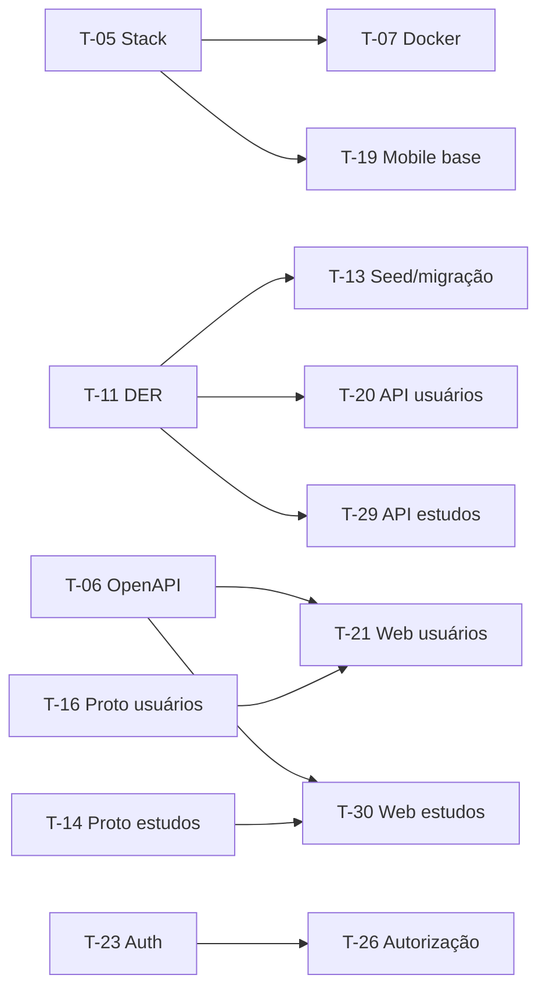

# Sprint 1 — ClinicalStudyPB

> [!info] Navegação
> Release 1 (Sprints 1 e 2) · Entrega em 09/11/2026 · Próxima: [[sprint-2]]

## 1. Contexto geral

- **Projeto:** ClinicalStudyPB, sistema simplificado de gestão do ciclo de vida de estudos clínicos (dados fictícios, sem decisão clínica automatizada).
- **Release 1 — Estrutura e recrutamento:** aplicação web funcional que permite cadastrar um estudo, avaliar candidatos e incluir participantes.
- **Objetivo da Sprint 1:** deixar a base pronta (repositório, ambiente, modelagem, protótipos) e entregar os requisitos **RF01 a RF04** (usuários, autenticação, autorização e cadastro de estudos).
- **Fora do escopo:** RF05 em diante (Sprint 2).
- **Rotação de papéis:** cada integrante assume um papel diferente a cada sprint. O papel define o foco, mas testes, documentação e revisão de código são **compartilhados** (exigência do projeto).

### Requisitos da sprint

| ID   | Requisito                                                                              |
| ---- | -------------------------------------------------------------------------------------- |
| RF01 | Cadastrar e gerenciar usuários (pesquisador, coordenador, administrador, participante) |
| RF02 | Autenticação e encerramento de sessão                                                  |
| RF03 | Restringir funcionalidades conforme o perfil                                           |
| RF04 | Cadastrar estudos (título, objetivo, responsável, datas, limite de participantes)      |

### Equipe e papéis nesta sprint

| #   | Papel                                                 | Responsável    | Foco                                             |
| --- | ----------------------------------------------------- | -------------- | ------------------------------------------------ |
| 1   | Líder técnico / Gerente                               | Nidlan Hendell | Organização, arquitetura, API, decisões técnicas |
| 2   | Desenvolvedor Backend                                 | Maria Eduarda  | Regras de negócio, persistência, testes          |
| 3   | Desenvolvedor Web (estudos, protocolos, usuários)     | Mirelle        | Telas de estudos                                 |
| 4   | Desenvolvedor Web (recrutamento, visitas, relatórios) | Adrielly       | Telas de usuários (nesta sprint)                 |
| 5   | Desenvolvedor Mobile                                  | Jasmine        | App do participante                              |
| 6   | QA / DevOps                                           | Arthur         | Ambiente, CI, qualidade                          |

## 2. Duração da sprint

- **Período:** 13/10/2026 a 26/10/2026 (14 dias, 10 dias úteis)
- **Planning:** 13/10
- **Checkpoint intermediário:** 19/10 
- **Review + Retrospectiva:** 26/10
- **Gerenciamento:** board e burndown no Azure DevOps

## 3. Backlog da sprint (Epic > User Story > Task)

> [!tip] Convenção
> `EP` = Epic · `US` = User Story · `T` = Task. Estimativas em horas (valores iniciais, a ajustar no planning). Responsável: número do papel (1 a 6).
> Itens marcados com 💡 foram **sugeridos** além do seu esboço, para cobrir o RF01–RF04 e as exigências do projeto. Podem ser cortados ou movidos.

### EP-01 — Fundação do projeto

**US-01.1** — Como equipe, quero repositório, board e decisões técnicas definidos para começar a desenvolver de forma organizada.

- [ ] **T-01** Planejar a sprint: separar, organizar e distribuir as atividades (este documento) · 1 · 3h
- [ ] **T-02** Diagrama de atividade do fluxo da sprint/do processo · 1 · 3h
- [ ] **T-03** 💡 Criar o board no Azure DevOps (PBIs, tasks, sprint, burndown) · 1 · 2h
- [ ] **T-04** 💡 Criar repositório GitHub com README.md principal (esqueleto), `releases/release1/README.md`, política de branches e pull requests · 1 · 3h
- [ ] **T-05** 💡 Decidir e justificar o stack (A, B ou C) e registrar no README · 1 · 3h
- [ ] **T-06** 💡 Esboçar o contrato da API para RF01–RF04 · 1 · 4h

**US-01.2** — Como equipe, quero um ambiente de desenvolvimento padronizado com Docker para que qualquer integrante (e a equipe da Release 3) rode o projeto igual.

- [ ] **T-07** Criar `docker-compose` com banco PostgreSQL + backend + web · 6 · 6h
- [ ] **T-08** Criar scripts/instruções de instalação e execução (seção do README) · 6 · 2h
(Opcional)
- [ ] **T-09** 💡 Configurar CI no GitHub Actions (build + testes a cada PR) · 6 · 5h
- [ ] **T-10** 💡 Configurar ferramentas de teste e cobertura (conforme stack) · 6 · 4h

### EP-02 — Modelagem e protótipos

**US-02.1** — Como equipe, quero o modelo de dados definido para que backend e telas usem a mesma estrutura.

- [ ] **T-11** MER/DER inicial (usuário/perfil, estudo; já prevendo candidato, critério, visita) · 2 · 6h
- [ ] **T-12** Revisão do DER por outro integrante (revisão cruzada) · 1 · 1h

**US-02.2** — Como pesquisador, quero ver o fluxo de cadastro de estudos em um protótipo para validar a navegação antes de codificar.

- [ ] **T-14** Protótipo navegável: listagem, cadastro e edição de estudo (Figma/Penpot) · 3 · 8h
- [ ] **T-15** Incluir no protótipo estados de erro/validação (campos obrigatórios, datas inválidas, limite de participantes) · 3 · 2h

**US-02.3** — Como administrador, quero ver o fluxo de cadastro de usuários em um protótipo para validar a navegação.

- [ ] **T-16** Protótipo navegável: login, listagem, cadastro e edição de usuário (com perfil) · 4 · 8h
- [ ] **T-17** Incluir no protótipo estados de erro (e-mail duplicado, senha inválida, acesso negado) · 4 · 2h

**US-02.4** — Como participante, quero as telas essenciais no celular para acessar o app.

- [ ] **T-18** Adaptar os protótipos para mobile: login e navegação base do participante · 5 · 8h

### EP-03 — Usuários, autenticação e autorização (RF01, RF02, RF03)

**US-03.1** — Como administrador, quero cadastrar e gerenciar usuários com perfis para controlar quem acessa o sistema. *(RF01)*

- [ ] ==🟢**T-20** 💡 Backend: entidade Usuário/Perfil, regras (e-mail único, ativar/desativar) e endpoints CRUD · 2 · 10h==
- [ ] **T-21** 💡 Web: telas de cadastro, listagem e edição de usuários integradas à API · 4 · 10h
- [ ] **T-22** 💡 Testes unitários e de integração do cadastro de usuários · 2 e 4 · 4h

**US-03.2** — Como usuário, quero entrar e sair do sistema para acessar minhas funcionalidades. *(RF02)*

- [ ] ==🟢**T-23** 💡 Backend: autenticação (login, token/sessão, logout) · 2 · 8h==
- [ ] **T-24** 💡 Web: tela de login e logout · 4 · 4h
- [ ] **T-25** 💡 Mobile: tela de login do participante (estrutura) · 5 · 5h

**US-03.3** — Como usuário, quero ver apenas o que meu perfil permite. *(RF03)*

- [ ] **T-26** 💡 Backend: controle de acesso por perfil nos endpoints · 2 · 6h
- [ ] **T-27** 💡 Web: menus e rotas restritos por perfil · 3 · 5h
- [ ] **T-28** 💡 Testes de autorização (acesso permitido/negado por perfil) · 6 · 4h

### EP-04 — Gestão de estudos (RF04)

**US-04.1** — Como pesquisador, quero cadastrar estudos com título, objetivo, responsável, datas e limite de participantes. *(RF04)*

- [ ] ==🟢**T-29** 💡 Backend: entidade Estudo, validações (datas, limite > 0) e endpoints · 2 · 10h==
- [ ] **T-30** 💡 Web: telas de listagem, cadastro e edição de estudos integradas à API · 3 · 10h
- [ ] **T-31** 💡 Testes unitários, de integração e de componente do cadastro de estudos · 2 e 3 · 5h

### Tarefas compartilhadas (todos)

- [ ] **T-32** Revisão de código cruzada em todos os PRs (mínimo 1 revisor) · todos
- [ ] **T-33** Documentação da sprint no `releases/release1/README.md` (parte de cada um) · todos
- [ ] **T-35** Preparar demonstração da sprint · todos

## 4. Distribuição por membro

| #   | Papel           | Tasks principais                                               | Horas (aprox.) |
| --- | --------------- | -------------------------------------------------------------- | -------------- |
| 1   | Líder / Gerente | T-01 a T-06, T-12, ==🟢T-20==, T-23,==🟢T-29==                 | ~23h           |
| 2   | Backend         | T-11, ==🟢T-20, T-23==, T-26, ==🟢T-29== (+ testes T-22, T-31) | ~31h           |
| 3   | Web (estudos)   | T-14, T-15, T-27, T-30 (+ testes T-31)                         | ~22h           |
| 4   | Web (usuários)  | T-16, T-17, T-21, T-24 (+ testes T-22)                         | ~22h           |
| 5   | Mobile          | T-18, T-25                                                     | ~13h           |
| 6   | QA / DevOps     | T-07 a T-10, T-28, T-31, T-22                                  | ~30h           |

### Dependências críticas

**Atenção:** T-05 (stack) desbloqueia Docker e o projeto mobile; deve ser decidido nos primeiros dias.

## 5. Registro da sprint (preencher ao longo e no fim)

### Review (26/10)

#### O que foi feito
- 

#### O que falta
- 

#### O que melhorar
- 

#### Impedimentos encontrados
- 

#### Ações de melhoria para a [[sprint-2]]
- [ ] 

### Burndown

> Inserir imagem exportada do Azure DevOps: `![[burndown-sprint1.png]]`

**Análise (planejado x realizado):**

### Contribuição por integrante

| # | Papel | Contribuição na sprint |
|---|---|---|
| 1 | Líder | |
| 2 | Backend | |
| 3 | Web (estudos) | |
| 4 | Web (usuários) | |
| 5 | Mobile | |
| 6 | QA / DevOps | |

### Requisitos da sprint — situação final

| RF | Concluído | Parcial | Não implementado | Justificativa |
|---|---|---|---|---|
| RF01 | ☐ | ☐ | ☐ | |
| RF02 | ☐ | ☐ | ☐ | |
| RF03 | ☐ | ☐ | ☐ | |
| RF04 | ☐ | ☐ | ☐ | |

