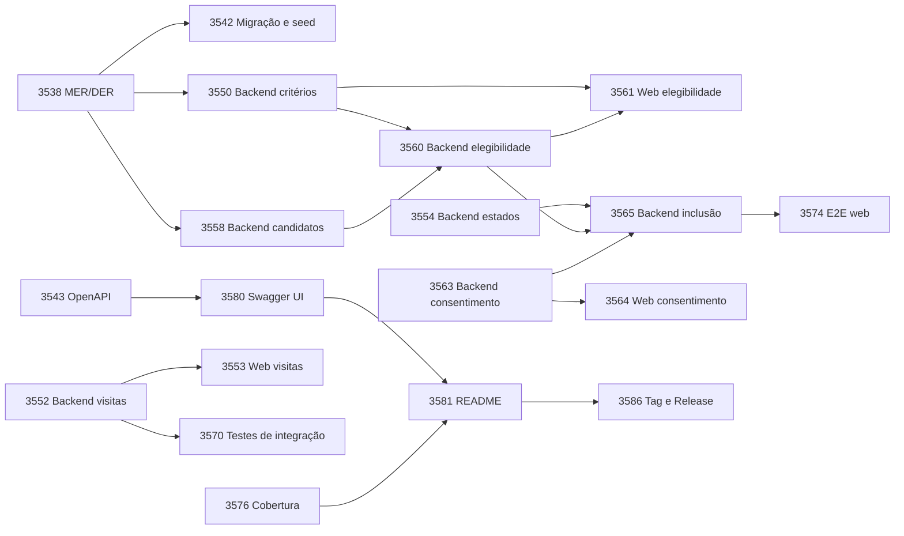

---
tags:
  - sprint
  - clinicalstudypb
  - eng-sw-2
sprint: 2
release: 1
inicio: 2026-10-27
fim: 2026-11-09
lider-da-sprint: Mirelle Casimiro Silvino
status: em andamento
---

# Sprint 2 — ClinicalStudyPB

> [!info] Navegação
> Release 1 (Sprints 1 e 2) · Entrega em 10/11/2026 · Anterior: [[sprint-1]]

## 1. Contexto geral

- **Projeto:** ClinicalStudyPB, sistema simplificado de gestão do ciclo de vida de estudos clínicos (dados fictícios, sem decisão clínica automatizada).
- **Release 1 — Estrutura e recrutamento:** aplicação web funcional que permite cadastrar um estudo, avaliar candidatos e incluir participantes.
- **Objetivo da Sprint 2:** entregar os requisitos **RF05 a RF11** (recrutamento), fechar as pendências da Sprint 1 (RF04 e qualidade), comprovar cobertura de testes ≥ 80% das linhas de negócio do backend e preparar a entrega da Release 1.
- **Fora do escopo:** funcionalidades da Release 2 e evolução do app mobile (congelado nesta release, ver T-43d).
- **Rotação de papéis:** cada integrante assume um papel diferente a cada sprint. O papel define o foco, mas testes, documentação e revisão de código são **compartilhados** (exigência do projeto).

### Requisitos da sprint

| ID | Requisito | PBI no Azure |
| --- | --- | --- |
| RF05 | Critérios de inclusão e exclusão | 3521 |
| RF06 | Visitas previstas e atividades | 3522 |
| RF07 | Estados do estudo | 3524 |
| RF08 | Cadastro de candidatos | 3525 |
| RF09 | Avaliação de elegibilidade | 3526 |
| RF10 | Consentimento simulado | 3527 |
| RF11 | Inclusão com limite de vagas | 3528 |
| RF04 / Qualidade | Pendências da Sprint 1 | 3520 |

### Equipe e papéis nesta sprint

| # | Papel | Responsável | Foco | Horas planejadas |
| --- | --- | --- | --- | --- |
| 1 | Gerente | Mirelle | Coordenação da sprint, backend de visitas (RF06) e estados (RF07), contrato OpenAPI, Swagger UI e README | 35h |
| 2 | Desenvolvedor Backend | Maria Eduarda | MER/DER, backend de candidatos (RF08), elegibilidade (RF09) e inclusão (RF11), testes do recrutamento | 37h |
| 3 | Desenvolvedor Web 1 | Nidlan Hendell | Protótipo e telas de critérios, visitas, estado do estudo e elegibilidade; testes de componente; capturas de tela | 40h |
| 4 | Desenvolvedor Web 2 | Jasmine | Integração dos estudos à API (RF04), protótipo do recrutamento, telas de candidatos, consentimento e inclusão; testes | 38h |
| 5 | Desenvolvedor Mobile | Arthur | Mobile congelado nesta sprint; CI e cobertura, migração e seed, backend de critérios (RF05) e consentimento (RF10), testes de integração | 25h |
| 6 | QA | Adrielly | QA: testes E2E, CI, relatório de cobertura, regressão e bug bash; testes do cadastro de estudos; credenciais; tag e Release | 28h |
| | | **Total** | | **203h** |

> [!info] Rotação
> Na Sprint 1 os papéis eram: Líder/Gerente Nidlan Hendell, Backend Maria Eduarda, Web (estudos) Mirelle, Web (usuários) Adrielly, Mobile Jasmine e QA/DevOps Arthur.

## 2. Duração da sprint

- **Período:** 27/10/2026 a 09/11/2026 (02/11 é feriado)
- **Planning:** 27/10
- **Prazos internos:** 29/10 (resposta da professora, task 3534) e 30/10 (contrato OpenAPI, task 3543)
- **Checkpoint intermediário:** 03/11
- **Feature freeze e bug bash:** 06/11
- **Review, retrospectiva e fechamento da Release 1:** 09/11 (capturas de tela, tag e GitHub Release); entrega em 10/11
- **Gerenciamento:** board e burndown no Azure DevOps, no máximo 2 tasks em Doing por pessoa

## 3. Backlog da sprint (PBI > Task)

> [!tip] Convenção
> Número = ID da task no Azure DevOps · Responsável · Horas estimadas · Início → fim previsto (dia em que vai para Done, com PR revisado e Remaining Work = 0).

### 3518 — Fechar dúvidas e modelo de dados de RF05–RF11 (Preparação)

- [ ] **3533** Planejar a sprint: separar, organizar e distribuir as atividades · Mirelle · 3h · 27/10 → 27/10
- [ ] **3534** Tirar dúvidas sobre a entidade Critério (RF05) e o registro da elegibilidade · Mirelle · 1h · 27/10 → 27/10
- [ ] **3536** Diagrama de atividade do fluxo de recrutamento (candidato > elegibilidade > consentimento > inclusão) · Mirelle · 3h · 28/10 → 29/10
- [ ] **3538** Atualizar o MER/DER com as entidades de RF05 a RF11 · Maria Eduarda · 6h · 27/10 → 28/10
- [ ] **3539** Revisão do DER por outro integrante (revisão cruzada) · Mirelle · 1h · 29/10 → 29/10
- [ ] **3542** Criar scripts de migração e seed com dados fictícios · Arthur · 4h · 28/10 → 29/10
- [ ] **3543** Atualizar o contrato OpenAPI para RF05–RF11 · Mirelle · 3h · 28/10 → 28/10

### 3520 — Concluir as pendências da Sprint 1 (RF04 / Qualidade)

- [ ] **3545** Integrar as telas web de estudos à API e ajustar ao OpenAPI (fecha o RF04) · Jasmine · 5h · 27/10 → 28/10
- [ ] **3546** Sincronizar develop: trazer cobertura (JaCoCo + Vitest) do PR #9 e mergear CI (feature/3049) · Arthur · 3h · 27/10 → 28/10
- [ ] **3548** Corrigir o board da Sprint 1: fechar 3153 e 3223, mover 3236 e 3237 como pendência e atualizar épicos · Mirelle · 1h · 27/10 → 27/10
- [ ] **T-43d (sem ID no board)** Congelar o app mobile: não evoluir as telas de estudos, visitas e retirada (RF17–RF20) e registrá-las no README da release · Arthur · 1h · 27/10 → 27/10
- [ ] **3641** Sincronizar develop com a master antes da entrega (PRs #1, #2 e #9) · Arthur · 1h · 28/10 → 28/10
- [ ] **3692** Corrigir permissões de estudos na web para que o pesquisador cadastre e edite (RF04) · Nidlan Hendell · 1h · 27/10 → 27/10
- [ ] **3236** Testes unitários, de integração e de componente do cadastro de estudos · Adrielly · 5h · 30/10 → 04/11

### 3224 — Gestão de estudos (RF04)

- [ ] **3236** Testes unitários, de integração e de componente do cadastro de estudos · Adrielly · 5h · 30/10 → 04/11

### 3521 — Critérios de inclusão e exclusão (RF05)

- [ ] **3549** Protótipo navegável: critérios de inclusão/exclusão e visitas previstas, com estados de erro · Nidlan Hendell · 6h · 27/10 → 28/10
- [ ] **3550** Backend: entidade Critério, vínculo com o estudo, validações e endpoints · Arthur · 8h · 29/10 → 30/10
- [ ] **3551** Web: tela de critérios integrada à API · Nidlan Hendell · 8h · 28/10 → 03/11

### 3522 — Visitas previstas e atividades (RF06)

- [ ] **3552** Backend: visita prevista e atividades (ordem, descrição, validações) e endpoints · Mirelle · 8h · 30/10 → 04/11
- [ ] **3553** Web: tela de visitas previstas e atividades integrada à API · Nidlan Hendell · 8h · 30/10 → 04/11

### 3524 — Estados do estudo (RF07)

- [ ] **3554** Backend: transições válidas entre estados, endpoint de mudança de estado e regras por estado · Mirelle · 6h · 29/10 → 30/10
- [ ] **3555** Web: controle do estado do estudo na tela de detalhe · Nidlan Hendell · 4h · 29/10 → 03/11
- [ ] **3556** Testes unitários: critérios, visitas previstas e transições de estado · Mirelle · 3h · 03/11 → 04/11
- [ ] **3556** Testes unitários: critérios, visitas previstas e transições de estado · Maria Eduarda · 3h · 05/11 → 05/11

### 3525 — Cadastro de candidatos (RF08)

- [ ] **3557** Protótipo navegável: candidatos, avaliação, consentimento e inclusão, com estados de erro (vagas esgotadas, sem consentimento, não elegível) · Jasmine · 8h · 27/10 → 29/10
- [ ] **3558** Backend: entidade Candidato vinculada ao estudo, validações e endpoints · Maria Eduarda · 8h · 28/10 → 30/10
- [ ] **3559** Web: telas de listagem e cadastro de candidatos integradas à API · Jasmine · 8h · 29/10 → 03/11

### 3526 — Avaliação de elegibilidade (RF09)

- [ ] **3560** Backend: avaliação dos critérios e resultado (elegível / não elegível) · Maria Eduarda · 8h · 30/10 → 03/11
- [ ] **3561** Web: tela de avaliação de elegibilidade · Nidlan Hendell · 8h · 04/11 → 05/11

### 3527 — Consentimento simulado (RF10)

- [ ] **3563** Backend: registro de consentimento (data, vínculo com candidato e estudo) · Arthur · 4h · 03/11 → 03/11
- [ ] **3564** Web: registro de consentimento · Jasmine · 4h · 03/11 → 04/11

### 3528 — Inclusão com limite de vagas (RF11)

- [ ] **3565** Backend: inclusão (exige elegível + consentimento + vaga disponível + estudo em recrutamento) · Maria Eduarda · 8h · 03/11 → 05/11
- [ ] **3566** Web: ação de incluir e mensagens de erro/validação · Jasmine · 5h · 04/11 → 05/11
- [ ] **3567** Testes unitários e de integração do recrutamento (elegibilidade, consentimento, limite de vagas) · Jasmine · 4h · 05/11 → 06/11
- [ ] **3568** Testes unitários e de integração do recrutamento (elegibilidade, consentimento, limite de vagas) · Maria Eduarda · 4h · 06/11 → 06/11

### 3529 — Testes automatizados e cobertura (Qualidade)

- [ ] **3570** Testes de integração dos endpoints de RF05–RF11 · Adrielly · 4h · 03/11 → 05/11
- [ ] **3570** Testes de integração dos endpoints de RF05–RF11 · Arthur · 4h · 04/11 → 04/11
- [ ] **3571** Testes de componente web: critérios, visitas e candidatos · Nidlan Hendell · 3h · 06/11 → 06/11
- [ ] **3572** Testes de componente web: critérios, visitas e candidatos · Jasmine · 3h · 05/11 → 05/11
- [ ] **3574** Teste E2E web: cadastrar estudo > cadastrar candidato > avaliar > consentir > incluir · Adrielly · 8h · 27/10 → 05/11
- [ ] **3575** Garantir CI executando testes e cobertura a cada PR (depois da 3546) · Adrielly · 3h · 29/10 → 29/10
- [ ] **3576** Relatório de testes e evidência de cobertura ≥ 80% das linhas de negócio do backend · Adrielly · 3h · 29/10 → 06/11
- [ ] **3577** Roteiro de regressão de RF01–RF04 e condução do bug bash (06/11) · Adrielly · 2h · 30/10 → 06/11

### 3530 — Entrega da Release 1 (Entrega)

- [ ] **3580** Swagger UI com RF01–RF11: adicionar springdoc-openapi ao backend e documentar os endpoints · Mirelle · 3h · 05/11 → 05/11
- [ ] **3581** README principal: apresentação, arquitetura, funcionalidades, stack, instalação, testes e API (corrigir UTF-8) · Mirelle · 3h · 05/11 → 06/11
- [ ] **3583** Capturas de tela das interfaces web (sucesso e erro/validação) · Nidlan Hendell · 2h · 09/11 → 09/11
- [ ] **3584** Capturas de tela das interfaces web (sucesso e erro/validação) · Jasmine · 1h · 09/11 → 09/11
- [ ] **3585** Documentar credenciais fictícias por perfil · Adrielly · 1h · 30/10 → 30/10
- [ ] **3586** Merge da develop na master, tag release1 e GitHub Release com resumo e link do README · Adrielly · 2h · 09/11 → 09/11

### Tarefas compartilhadas (todos)

- [ ] Revisão de código cruzada em todos os PRs (mínimo 1 revisor)
- [ ] Documentação da sprint (parte de cada um)
- [ ] Preparar a demonstração da Release 1

## 4. Distribuição por membro

| # | Papel | Responsável | Horas | Tasks |
| --- | --- | --- | --- | --- |
| 1 | Gerente | Mirelle | 35h | 3533, 3534, 3536, 3539, 3543, 3548, 3552, 3554, 3556, 3580, 3581 |
| 2 | Desenvolvedor Backend | Maria Eduarda | 37h | 3538, 3556, 3558, 3560, 3565, 3568 |
| 3 | Desenvolvedor Web 1 | Nidlan Hendell | 40h | 3692, 3549, 3551, 3553, 3555, 3561, 3571, 3583 |
| 4 | Desenvolvedor Web 2 | Jasmine | 38h | 3545, 3557, 3559, 3564, 3566, 3567, 3572, 3584 |
| 5 | Desenvolvedor Mobile | Arthur | 25h | 3542, 3546, T-43d, 3641, 3550, 3563, 3570 |
| 6 | QA | Adrielly | 28h | 3236, 3570, 3574, 3575, 3576, 3577, 3585, 3586 |
| | **Total** | | **203h** | |

## 5. Horas planejadas por dia

Linha ideal do burndown: total de 203h menos as horas acumuladas planejadas até o fim de cada dia.

| Dia | Data | Evento | Mirelle | Maria Eduarda | Nidlan | Jasmine | Arthur | Adrielly | Total do dia | Restante ideal |
| --- | --- | --- | --- | --- | --- | --- | --- | --- | --- | --- |
| 1 | 27/10 | Planning / início da sprint | 5 | 4 | 5 | 5 | 4 | 3 | 26 | 177 |
| 2 | 28/10 |  | 5 | 5 | 5 | 5 | 4 | 3 | 27 | 150 |
| 3 | 29/10 | Prazo da professora (3534) | 5 | 4 | 5 | 5 | 5 | 4 | 28 | 122 |
| 4 | 30/10 | Prazo do OpenAPI (3543) | 5 | 5 | 5 | 4 | 4 | 5 | 28 | 94 |
| 5 | 03/11 | Checkpoint intermediário | 5 | 5 | 5 | 5 | 4 | 4 | 28 | 66 |
| 6 | 04/11 |  | 4 | 5 | 5 | 5 | 4 | 3 | 26 | 40 |
| 7 | 05/11 |  | 4 | 5 | 5 | 5 | 0 | 2 | 21 | 19 |
| 8 | 06/11 | Feature freeze + bug bash | 2 | 4 | 3 | 3 | 0 | 2 | 14 | 5 |
| 9 | 09/11 | Review, retrospectiva e entrega da Release 1 | 0 | 0 | 2 | 1 | 0 | 2 | 5 | 0 |
| | | **Total** | **35** | **37** | **40** | **38** | **25** | **28** | **203** | |

### Dependências críticas

**Atenção:** o caminho crítico passa por 3538 → 3558/3550 → 3560 → 3565 → 3574, sem folga: a 3565 (inclusão) termina em 05/11, um dia antes do feature freeze.

### Riscos e plano B

| Risco | Plano B |
| --- | --- |
| 3560 (elegibilidade) passa de 03/11 | Arthur assume a parte de backend dos testes do recrutamento e Maria Eduarda fica só na 3565 |
| Nidlan e Jasmine com cerca de 5h por dia quase o tempo todo | Se no checkpoint o restante estiver acima de ~70h, cortar a 3553 (web de visitas); o RF06 continua entregue pela API e fica parcial no README |
| Migrações Flyway criadas por 3542, 3550, 3552 e 3558 | Combinar a numeração e a ordem de merge (V5 de critérios antes da V6 de visitas) para evitar conflito |
| Resposta da professora (3534) atrasada | Seguir a proposta provisória e avisar Maria Eduarda e Arthur |
| Acesso aos critérios inconsistente entre o PBI 3521 e a task 3550 (coordenador consulta?) | Decidir e ajustar o texto do PBI e das tasks 3550 e 3551 |

## 6. Registro da sprint (preencher ao longo e no fim)

### Review

#### O que foi feito
- 

#### O que falta
- 

#### O que melhorar
- 

#### Impedimentos encontrados
- 

#### Ações de melhoria para a Release 2
- [ ] 

### Burndown

> Inserir imagem exportada do Azure DevOps: `![[burndown-sprint2.png]]`

**Análise (planejado x realizado):**

### Contribuição por integrante

| # | Papel | Responsável | Contribuição na sprint |
| --- | --- | --- | --- |
| 1 | Gerente | Mirelle | |
| 2 | Backend | Maria Eduarda | |
| 3 | Web 1 | Nidlan Hendell | |
| 4 | Web 2 | Jasmine | |
| 5 | Mobile | Arthur | |
| 6 | QA | Adrielly | |

### Requisitos da sprint — situação final

| RF | Concluído | Parcial | Não implementado | Justificativa |
| --- | --- | --- | --- | --- |
| RF04 (pendência) | ☐ | ☐ | ☐ | |
| RF05 | ☐ | ☐ | ☐ | |
| RF06 | ☐ | ☐ | ☐ | |
| RF07 | ☐ | ☐ | ☐ | |
| RF08 | ☐ | ☐ | ☐ | |
| RF09 | ☐ | ☐ | ☐ | |
| RF10 | ☐ | ☐ | ☐ | |
| RF11 | ☐ | ☐ | ☐ | |
