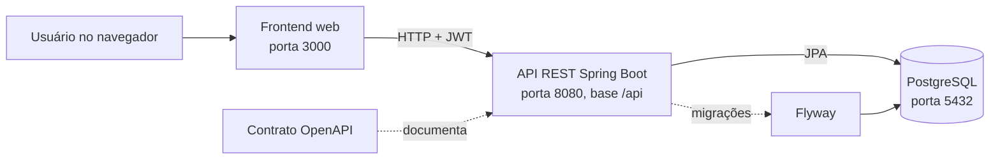

# ClinicalStudyPB

Sistema simplificado de gestão do ciclo de vida de estudos clínicos, desenvolvido na disciplina de Engenharia de Software II (UEPB, 2026.2).


## Sumário

- [Sobre o projeto](#sobre-o-projeto)
- [Release 1: escopo](#release-1-escopo)
- [Arquitetura](#arquitetura)
- [Stack](#stack)
- [Como executar](#como-executar)
- [Testes e cobertura](#testes-e-cobertura)
- [API e documentação interativa](#api-e-documentação-interativa)
- [Estrutura do repositório](#estrutura-do-repositório)
- [Fluxo de trabalho](#fluxo-de-trabalho)
- [Equipe e papéis](#equipe-e-papéis)

## Sobre o projeto

O ClinicalStudyPB reproduz, de forma simplificada, o ciclo de vida de um estudo clínico: o pesquisador cadastra o estudo e define os critérios de inclusão e exclusão e as visitas previstas; o coordenador cadastra os candidatos, avalia a elegibilidade, registra o consentimento e inclui participantes respeitando o limite de vagas.

O desenvolvimento segue Scrum, com o board, as sprints e o burndown no Azure DevOps. A cada sprint os papéis da equipe rotacionam; testes, documentação e revisão de código são responsabilidade de todos.

## Release 1: escopo

A Release 1 (**Estrutura e recrutamento**) reúne as Sprints 1 e 2 e entrega uma aplicação web que permite cadastrar um estudo, avaliar candidatos e incluir participantes. **Entregue em 10/11/2026** (merge da `develop` na `master` pelo PR #50).

| ID | Requisito | Sprint | Situação |
| --- | --- | --- | --- |
| RF01 | Cadastrar e gerenciar usuários (pesquisador, coordenador, administrador, participante) | 1 | Entregue |
| RF02 | Autenticação e encerramento de sessão | 1 | Entregue |
| RF03 | Restringir funcionalidades conforme o perfil | 1 | Entregue |
| RF04 | Cadastrar estudos (título, objetivo, responsável, datas, limite de participantes) | 1 (fechado na 2) | Entregue |
| RF05 | Critérios de inclusão e exclusão | 2 | Entregue |
| RF06 | Visitas previstas e atividades | 2 | Entregue |
| RF07 | Estados do estudo | 2 | Entregue |
| RF08 | Cadastro de candidatos | 2 | Entregue |
| RF09 | Avaliação de elegibilidade | 2 | Entregue |
| RF10 | Consentimento simulado | 2 | Entregue |
| RF11 | Inclusão com limite de vagas | 2 | Entregue |

**App mobile:** o desenvolvimento foi congelado nesta release. Os requisitos RF17 a RF20 (estudos, visitas e retirada) ficam para a Release 2.

A situação de cada requisito, as evidências e as capturas de tela estão no [README da Release 1](releases/README-release1.md). Os testes e a cobertura estão no [relatório de testes](releases/release1/relatorio-testes.md).

## Arquitetura



- **Frontend web:** telas por perfil (menus e rotas restritos conforme o perfil do usuário).
- **Backend:** API REST organizada em pacotes por funcionalidade (por exemplo `estudo`, `candidato` e `visitaprevista`, além do pacote `config` com a segurança). A autenticação usa token JWT e o acesso às rotas é controlado por perfil.
- **Banco de dados:** PostgreSQL, com o esquema criado e versionado pelo Flyway na inicialização da API.
- **Contrato da API:** descrito em OpenAPI (`openapi.yaml`) e publicado no Swagger UI, gerado pelo springdoc-openapi.

O modelo de dados está em [`Docs/ClinicalStudyPB-Docs/Diagramas/MER-v2.md`](Docs/ClinicalStudyPB-Docs/Diagramas/MER-v2.md).

## Stack

| Camada | Tecnologia |
| --- | --- |
| Backend | Java 21, Spring Boot 4, Maven (wrapper `mvnw`), Spring Security com JWT, JPA/Hibernate, Flyway |
| Banco de dados | PostgreSQL 17 |
| Frontend web | React 19, TypeScript, Vite, React Router e Axios |
| Mobile | React Native com Expo (congelado nesta release) |
| Documentação da API | Contrato OpenAPI (`openapi.yaml`) e Swagger UI com springdoc-openapi |
| Testes e cobertura | JUnit 5, Mockito e JaCoCo (backend); Vitest e Testing Library (frontend); Playwright (E2E) |
| Infraestrutura | Docker e Docker Compose |
| Integração contínua | GitHub Actions (testes e cobertura a cada pull request) |
| Gestão | Azure DevOps (board, sprints e burndown) |

## Como executar

### Pré-requisito

- Docker Desktop instalado e em execução (no Windows, com o WSL 2 habilitado).

### Subir o projeto

Na raiz do repositório:

```bash
docker compose up --build
```

Depois, acesse:

| Serviço | Endereço |
| --- | --- |
| Frontend | <http://localhost:3000> |
| API | <http://localhost:8080/api> |
| Swagger UI | <http://localhost:8080/api/swagger-ui.html> |
| PostgreSQL | `localhost:5432` |

As migrações do Flyway rodam automaticamente na primeira inicialização. Para executar em segundo plano use `docker compose up --build -d`, e para parar use `docker compose down`.

Os detalhes (logs, volumes, remoção dos dados e configuração de produção com `JWT_SECRET`) estão em [`DOCKER.md`](DOCKER.md).

### Credenciais fictícias

A migração V2 cria um usuário de teste para cada perfil. Os dados são fictícios e valem apenas para o ambiente de desenvolvimento e avaliação.

| Perfil | E-mail | Senha |
| --- | --- | --- |
| ADMINISTRADOR | `admin@clinicalstudypb.test` | `Senha@123` |
| PESQUISADOR | `pesquisador@clinicalstudypb.test` | `Senha@123` |
| COORDENADOR | `coordenador@clinicalstudypb.test` | `Senha@123` |
| PARTICIPANTE | `participante@clinicalstudypb.test` | `Senha@123` |


### Dados de demonstração

A migração V10 cria dados fictícios para explorar o sistema sem cadastro manual: cinco estudos, um em cada estado (com critérios e visitas), e candidatos em todos os status. Por exemplo, o estudo de diabetes tem candidatos em todos os status, e o de asma está com as vagas esgotadas.

Para voltar aos dados iniciais, recrie o banco com `docker compose down -v` e depois `docker compose up -d`.

## Testes e cobertura

Backend (na pasta `backend/clinicalstudypb-api`, com o banco no ar pelo Docker):

```bash
./mvnw clean test      # roda os testes
./mvnw verify          # roda os testes e gera o relatório de cobertura
```

O relatório do JaCoCo fica em `backend/clinicalstudypb-api/target/site/jacoco/index.html`. A meta da release é **cobertura de pelo menos 80% das linhas de negócio do backend**.

Frontend (na pasta `frontend/frontend`):

```bash
npm test                 # roda os testes
npm run test:coverage    # roda os testes e gera a cobertura
```

E2E (na pasta `e2e`, com o projeto no ar pelo Docker Compose). Detalhes no [README do E2E](e2e/README.md):

```bash
npm install
npx playwright install chromium
npm test
```

### Resultado da Release 1

| Item | Resultado |
| --- | --- |
| Testes automatizados | 531 de 531 passaram (328 no backend e 203 no frontend) |
| Cobertura de linhas do backend | 97,9% (meta de 80%) |
| Cobertura de linhas do frontend | 89,3% |
| E2E do fluxo de recrutamento | Passou |
| Regressão manual (RF01 a RF04) | 34 de 34 OK |
| Bug bash (RF05 a RF11) | 23 de 24 OK, sem bug bloqueante |

Os detalhes estão no [relatório de testes](releases/release1/relatorio-testes.md), e a execução manual, com prints, em [`Docs/ClinicalStudyPB-Docs/Testes`](Docs/ClinicalStudyPB-Docs/Testes).

O GitHub Actions roda o build e os testes do backend e do frontend a cada push e pull request. Pela regra do time, um PR só é mesclado com o CI verde e ao menos uma revisão.

## API e documentação interativa

- **Base da API:** `http://localhost:8080/api`
- **Swagger UI:** <http://localhost:8080/api/swagger-ui.html>. Para testar as rotas protegidas, faça login em `POST /api/auth/login`, clique em **Authorize** e informe o token.
- **Contrato OpenAPI:** [`Docs/ClinicalStudyPB-Docs/api/openapi.yaml`](Docs/ClinicalStudyPB-Docs/api/openapi.yaml)
- **Autenticação:** faça login para obter o token e envie-o no cabeçalho `Authorization: Bearer <token>`. As rotas são restritas por perfil.

## Estrutura do repositório

```text
.
├── backend/                 # API Spring Boot (clinicalstudypb-api)
├── frontend/                # aplicação web (código e testes em frontend/frontend)
├── mobile/                  # app do participante (congelado na Release 1)
├── e2e/                     # teste E2E com Playwright
├── Docs/ClinicalStudyPB-Docs/
│   ├── Contexto-Geral/      # contexto e requisitos
│   ├── Diagramas/           # MER/DER e diagrama do fluxo de recrutamento
│   ├── Sprints/             # planejamento e registro de cada sprint
│   ├── Testes/              # roteiro de regressão, bug bash e resultado da execução
│   └── api/                 # contrato OpenAPI
├── releases/                # documentação e relatório de testes de cada release
├── .github/                 # workflows de CI
├── docker-compose.yml
├── DOCKER.md
└── .env.example
```

## Fluxo de trabalho

- **Branches:** `master` guarda as releases e `develop` integra o trabalho. Cada task usa uma branch própria a partir da `develop`, com prefixo por tipo e o ID do Azure DevOps, por exemplo `feat/3552-backend-visitas-atividades` ou `docs/3581-readme-principal`.
- **Commits:** mensagens no padrão `tipo(escopo): descrição AB#ID`, como `feat(visitas): expõe endpoints REST AB#3552`. O `AB#ID` liga o commit à task no Azure Boards.
- **Pull requests:** sempre para a `develop`, com descrição, passos para testar e checklist do autor e do revisor. Exigem revisão cruzada de ao menos uma pessoa e o CI verde.
- **Release:** a `develop` é mesclada na `master`, recebe a tag da release e um GitHub Release com o resumo e o link para a documentação.

## Equipe e papéis

Os papéis rotacionam a cada sprint.

| Papel | Sprint 1 | Sprint 2 |
| --- | --- | --- |
| Líder técnico / Gerente | Nidlan Hendell | Mirelle |
| Backend | Maria Eduarda | Maria Eduarda |
| Web 1 (estudos, protocolos, usuários) | Mirelle | Nidlan Hendell |
| Web 2 (recrutamento, visitas, relatórios) | Adrielly | Jasmine |
| Mobile | Jasmine | Arthur |
| QA / DevOps | Arthur | Adrielly |

A documentação completa de cada sprint está em [`Docs/ClinicalStudyPB-Docs/Sprints`](Docs/ClinicalStudyPB-Docs/Sprints).