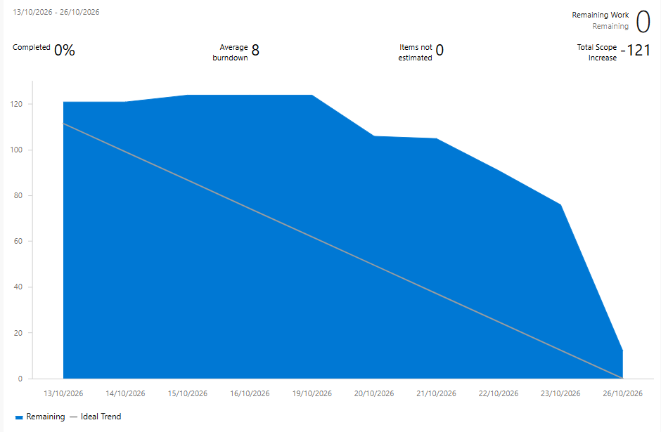

# Release 1: Estrutura e recrutamento

Documentação da primeira release do ClinicalStudyPB, que reúne as Sprints 1 e 2 e entrega uma aplicação web para cadastrar estudos clínicos, avaliar candidatos e incluir participantes. Todos os dados são fictícios.

- **Período:** 13/10/2026 a 10/11/2026 (Sprint 1: 13/10 a 26/10; Sprint 2: 27/10 a 09/11; fechamento e entrega: 10/11).
- **Tag:** `release1`
- **GitHub Release:** a confirmar (task 3586).
- **README principal:** [`README.md`](../README.md)
- **Como executar:** [`DOCKER.md`](../DOCKER.md)

## 1. Requisitos da release: situação final

Marque a situação de cada requisito ao fim da Sprint 2 e justifique os parciais.

| RF | Requisito | Sprint | Concluído | Parcial | Não implementado | Justificativa |
| --- | --- | --- | --- | --- | --- | --- |
| RF01 | Cadastrar e gerenciar usuários | 1 | ☐ | ☐ | ☐ | |
| RF02 | Autenticação e encerramento de sessão | 1 | ☐ | ☐ | ☐ | |
| RF03 | Restringir funcionalidades conforme o perfil | 1 | ☐ | ☐ | ☐ | |
| RF04 | Cadastrar estudos | 1 e 2 | ☐ | ☐ | ☐ | |
| RF05 | Critérios de inclusão e exclusão | 2 | ☐ | ☐ | ☐ | |
| RF06 | Visitas previstas e atividades | 2 | ☐ | ☐ | ☐ | |
| RF07 | Estados do estudo | 2 | ☐ | ☐ | ☐ | |
| RF08 | Cadastro de candidatos | 2 | ☐ | ☐ | ☐ | |
| RF09 | Avaliação de elegibilidade | 2 | ☐ | ☐ | ☐ | |
| RF10 | Consentimento simulado | 2 | ☐ | ☐ | ☐ | |
| RF11 | Inclusão com limite de vagas | 2 | ☐ | ☐ | ☐ | |

## 2. Fora do escopo desta release

### App mobile congelado

O app do participante não evoluiu nesta release. As telas de estudos, visitas e retirada (**RF17 a RF20**) foram congeladas na Sprint 2 (task T-43d) e ficam para a Release 2. 
O projeto mobile continua no repositório, na pasta `mobile/`, com a estrutura e o login definidos na Sprint 1.

### Limitações conhecidas

- O aplicativo mobile não foi desenvolvido além da estrutura e do login definidos na Sprint 1.

- As funcionalidades relacionadas às telas de estudos, visitas e retirada do participante (RF17 a RF20) foram adiadas para a Release 2.

- Outras funcionalidades parciais ou não implementadas devem ser registradas após a validação dos requisitos RF01 a RF11 e das evidências da Sprint 2.

## 3. Sprints

| Sprint | Período | Objetivo | Documento |
| --- | --- | --- | --- |
| 1 | 13/10 a 26/10 | Base do projeto (repositório, ambiente, modelagem, protótipos) e RF01 a RF04 | [`sprint-1.md`](../Docs/ClinicalStudyPB-Docs/Sprints/sprint-1.md) |
| 2 | 27/10 a 09/11 | RF05 a RF11, pendências da Sprint 1, cobertura mínima de 80% e preparação da release. | [`sprint-2.md`](../Docs/ClinicalStudyPB-Docs/Sprints/sprint-2.md) |

### Papéis por sprint

| Papel | Sprint 1 | Sprint 2 |
| --- | --- | --- |
| Líder técnico / Gerente | Nidlan Hendell | Mirelle |
| Backend | Maria Eduarda | Maria Eduarda |
| Web 1 (estudos, protocolos, usuários) | Mirelle | Nidlan Hendell |
| Web 2 (recrutamento, visitas, relatórios) | Adrielly | Jasmine |
| Mobile | Jasmine | Arthur |
| QA / DevOps | Arthur | Adrielly |

### Burndown

**Sprint 1 (13/10/2026 a 26/10/2026)**

**Sprint 2 (27/10/2026 a 09/11/2026)**

obs:imagem a ser adicionada no final da sprint.

## 4. Evidências

| Evidência | Onde encontrar |
| --- | --- |
| Relatório de testes e cobertura ≥ 80% (task 3576) | [CONFIRMAR: link ou caminho do relatório] |
| Capturas de tela da interface web, com sucesso e erro/validação (tasks 3583 e 3584) | [CONFIRMAR: pasta das capturas] |
| Credenciais fictícias por perfil (task 3585) | [README principal, seção Credenciais fictícias](../README.md#credenciais-fictícias) |
| Swagger UI com RF01 a RF11 (task 3580) | [CONFIRMAR: endereço do Swagger UI, depois que a task 3580 for mesclada] |
| Contrato OpenAPI | [`openapi.yaml`](../Docs/ClinicalStudyPB-Docs/api/openapi.yaml) |
| Modelo de dados (MER/DER) | [`MER-v2.md`](../Docs/ClinicalStudyPB-Docs/Diagramas/MER-v2.md) |
| Protótipos navegáveis | [Figma – ClinicalStudyPB](https://www.figma.com/design/P2s0uMXHZCh3vrgC5ZmfNG/ClinicalStudyPB---ES2?node-id=20-2&t=0cEoxDphdCsPHFBn-0). |
| Teste E2E do fluxo completo (cadastrar estudo, cadastrar candidato, avaliar, consentir e incluir) | [CONFIRMAR: link do workflow ou do teste] |

## 5. Decisões técnicas

**Stack:** 
- **Backend:** Java 21, Spring Boot e Maven, com Spring Security e autenticação JWT. A API utiliza JPA/Hibernate para persistência.
- **Frontend web:** aplicação web separada do backend. Framework e versão devem ser confirmados na configuração do projeto.
- **Ambiente:** Docker Compose com banco, backend e frontend, para qualquer integrante rodar o projeto do mesmo jeito.
- **Banco:** migrações versionadas com Flyway, executadas na inicialização da API.
- **Qualidade:** integração contínua com testes e cobertura a cada pull request, revisão cruzada obrigatória e cobertura mínima de 80% das linhas de negócio do backend.
- **Gestão:** Scrum, com planejamento, acompanhamento das tarefas e burndown pelo Azure DevOps.

## 6. Próximos passos (Release 2)

- Retomar o desenvolvimento do aplicativo mobile do participante, contemplando os requisitos RF17 a RF20.

- Implementar as telas de estudos, visitas e retirada do participante.

- Corrigir eventuais pendências identificadas durante a validação da Release 1.

- Aplicar as melhorias identificadas na retrospectiva da Sprint 2.

- Atualizar a documentação e as evidências conforme a evolução das funcionalidades.
