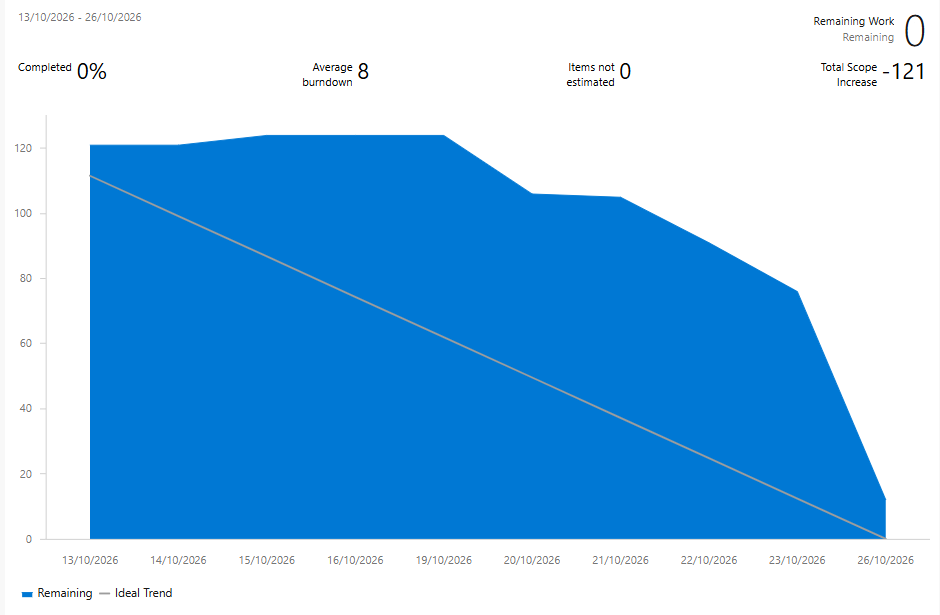
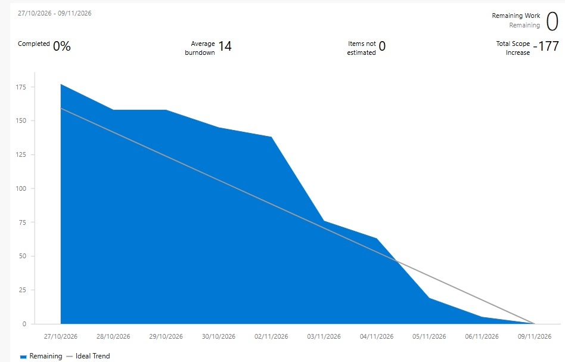

# Release 1: Estrutura e recrutamento

Documentação da primeira release do ClinicalStudyPB, que reúne as Sprints 1 e 2 e entrega uma aplicação web para cadastrar estudos clínicos, avaliar candidatos e incluir participantes. Todos os dados são fictícios.

- **Período:** 13/10/2026 a 10/11/2026 (Sprint 1: 13/10 a 26/10; Sprint 2: 27/10 a 09/11; fechamento e entrega: 10/11).
- **Tag:** `v1.0.0`, sobre o merge da `develop` na `master` (PR #50).
- **GitHub Release:** [Release 1](https://github.com/N1dlan95/ClinicalStudyPB-ESW-2/releases/tag/v1.0.0), publicado em 09/11/2026 (task 3586).
- **README principal:** [`README.md`](../../README.md)
- **Como executar:** [`DOCKER.md`](../../DOCKER.md)

## 1. Requisitos da release: situação final

Situação de cada requisito ao fim da Sprint 2. A validação é a da execução de 09/11/2026: regressão de RF01 a RF04 com 34 de 34 casos OK, bug bash de RF05 a RF11 com 23 de 24 OK e E2E do fluxo de recrutamento aprovado ([relatório de testes](relatorio-testes.md)).

| RF | Requisito | Sprint | Concluído | Parcial | Não implementado | Justificativa |
| --- | --- | --- | --- | --- | --- | --- |
| RF01 | Cadastrar e gerenciar usuários | 1 | ☒ | ☐ | ☐ | CRUD de usuários com e-mail único, ativação e desativação e bloqueio do próprio usuário; tela web integrada à API. |
| RF02 | Autenticação e encerramento de sessão | 1 | ☒ | ☐ | ☐ | Login com JWT, sessão persistente, logout, bloqueio de usuário inativo e do participante no painel web. |
| RF03 | Restringir funcionalidades conforme o perfil | 1 | ☒ | ☐ | ☐ | Regras por perfil no `SecurityConfig` e menus e rotas restritos na web, com testes de autorização. |
| RF04 | Cadastrar estudos | 1 e 2 | ☒ | ☐ | ☐ | Pendência da Sprint 1 fechada na Sprint 2: telas integradas à API (3545), criação e edição só para o pesquisador (3692) e testes (3236). |
| RF05 | Critérios de inclusão e exclusão | 2 | ☒ | ☐ | ☐ | API de critérios com regras por estado do estudo (3550) e tela de critérios (3551). |
| RF06 | Visitas previstas e atividades | 2 | ☒ | ☐ | ☐ | Visitas previstas com ordem e atividades (3552) e tela (3553). A data e a hora das visitas agendadas não fazem parte do RF06 e entram com o RF12. |
| RF07 | Estados do estudo | 2 | ☒ | ☐ | ☐ | Transições PLANEJAMENTO → RECRUTAMENTO → EXECUCAO → ENCERRADO, `PATCH /estudos/{id}/estado` (3554) e controle na tela (3555). As transições foram definidas pelo grupo, porque o enunciado só lista os estados. |
| RF08 | Cadastro de candidatos | 2 | ☒ | ☐ | ☐ | Candidato vinculado ao estudo, com e-mail único dentro do estudo (3558), e telas de listagem e cadastro (3559). Bug de severidade baixa em aberto: o filtro não tem a opção "Retirado". |
| RF09 | Avaliação de elegibilidade | 2 | ☒ | ☐ | ☐ | Avaliação critério por critério com resultado calculado (3560) e tela de avaliação (3561). |
| RF10 | Consentimento simulado | 2 | ☒ | ☐ | ☐ | Registro de consentimento com data e responsável, bloqueado para não elegível e para estudo encerrado (3563, PR #42), e tela (3564). |
| RF11 | Inclusão com limite de vagas | 2 | ☒ | ☐ | ☐ | A inclusão exige candidato elegível, consentimento, vaga e estudo em recrutamento (3565); tela com contador de vagas (3566). Bug de severidade baixa: texto "1 vagas" sem singular. |

## 2. Fora do escopo desta release

### App mobile congelado

O app do participante não evoluiu nesta release. As telas de estudos, visitas e retirada (**RF17 a RF20**) foram congeladas na Sprint 2 (task T-43d) e ficam para a Release 2. 
O projeto mobile continua no repositório, na pasta `mobile/`, com a estrutura e o login definidos na Sprint 1.

### Limitações conhecidas

- O aplicativo mobile não foi desenvolvido além da estrutura e do login definidos na Sprint 1.

- As funcionalidades relacionadas às telas de estudos, visitas e retirada do participante (RF17 a RF20) foram adiadas para a Release 2.

- Visitas previstas guardam dia previsto e janela de dias. A data e a hora da visita agendada ficam para o RF12, na Release 2.

- Dois bugs de severidade baixa, que não bloqueiam a entrega: o filtro de candidatos não tem a opção "Retirado", e o texto de vagas não usa o singular ("1 vagas"). Os dois ficam para a Release 2.

- Faltam as capturas das telas de estudos, critérios, visitas, estado do estudo e avaliação (task 3583). Essas telas aparecem nos prints da regressão e do E2E.

## 3. Sprints

| Sprint | Período | Objetivo | Documento |
| --- | --- | --- | --- |
| 1 | 13/10 a 26/10 | Base do projeto (repositório, ambiente, modelagem, protótipos) e RF01 a RF04 | [`sprint-1.md`](sprints/sprint-1.md) |
| 2 | 27/10 a 09/11 | RF05 a RF11, pendências da Sprint 1, cobertura mínima de 80% e preparação da release. | [`sprint-2.md`](sprints/sprint-2.md) |

### Papéis por sprint

| Papel | Sprint 1 | Sprint 2 |
| --- | --- | --- |
| Líder técnico / Gerente | Nidlan Hendell | Mirelle |
| Backend | Maria Eduarda | Maria Eduarda |
| Web 1 (estudos, protocolos, usuários) | Mirelle | Nidlan Hendell |
| Web 2 (recrutamento, visitas, relatórios) | Adrielly | Jasmine |
| Mobile | Jasmine | Arthur |
| QA / DevOps | Arthur | Adrielly |

### Burndown

**Sprint 1 (13/10/2026 a 26/10/2026)**

**Sprint 2 (27/10/2026 a 09/11/2026)**

O trabalho restante ficou acima da linha ideal até 02/11, caiu bastante no checkpoint de 03/11, passou para baixo do ideal entre 04/11 e 05/11 e chegou a 0h em 09/11. A análise completa está no [`sprint-2.md`](sprints/sprint-2.md).

## 4. Evidências

| Evidência | Onde encontrar |
| --- | --- |
| Relatório de testes e cobertura ≥ 80% (task 3576) | [`relatorio-testes.md`](relatorio-testes.md): 531 testes passando, 97,9% das linhas do backend cobertas e [CI verde](https://github.com/N1dlan95/ClinicalStudyPB-ESW-2/actions/runs/42729880697) |
| Capturas de tela da interface web, com sucesso e erro/validação (tasks 3583 e 3584) | [`img/`](img/) (candidatos, consentimento e inclusão, task 3584); prints da regressão e do bug bash em [`Testes/evidencias/`](../../Docs/ClinicalStudyPB-Docs/Testes/evidencias/). Capturas da task 3583 pendentes |
| Credenciais fictícias por perfil (task 3585) | [README principal, seção Credenciais fictícias](../../README.md#credenciais-fictícias) |
| Swagger UI com RF01 a RF11 (task 3580) | <http://localhost:8080/api/swagger-ui.html>, com o projeto rodando (PR #40) |
| Contrato OpenAPI | [`openapi.yaml`](../../Docs/ClinicalStudyPB-Docs/api/openapi.yaml) |
| Modelo de dados (MER/DER) | [`MER-v2.md`](../../Docs/ClinicalStudyPB-Docs/Diagramas/MER-v2.md) |
| Protótipos navegáveis | [Figma – ClinicalStudyPB](https://www.figma.com/design/P2s0uMXHZCh3vrgC5ZmfNG/ClinicalStudyPB---ES2?node-id=20-2&t=0cEoxDphdCsPHFBn-0). |
| Teste E2E do fluxo completo (cadastrar estudo, cadastrar candidato, avaliar, consentir e incluir) | [`e2e/tests/fluxo-recrutamento.spec.ts`](../../e2e/tests/fluxo-recrutamento.spec.ts) (Playwright), com os prints em [`e2e/evidencias/`](../../e2e/evidencias/) e o passo a passo em [`e2e/README.md`](../../e2e/README.md) |

## 5. Decisões técnicas

**Stack:** 
- **Backend:** Java 21, Spring Boot 4 e Maven, com Spring Security e autenticação JWT. A API utiliza JPA/Hibernate para persistência.
- **Frontend web:** React 19 com TypeScript, Vite e React Router, separado do backend; testes com Vitest e Testing Library.
- **Ambiente:** Docker Compose com banco, backend e frontend, para qualquer integrante rodar o projeto do mesmo jeito.
- **Banco:** PostgreSQL 17, com migrações versionadas pelo Flyway, executadas na inicialização da API.
- **Qualidade:** integração contínua com testes e cobertura a cada pull request, revisão cruzada obrigatória e cobertura mínima de 80% das linhas de negócio do backend.
- **Gestão:** Scrum, com planejamento, acompanhamento das tarefas e burndown pelo Azure DevOps.

## 6. Próximos passos (Release 2)

- Retomar o desenvolvimento do aplicativo mobile do participante, contemplando os requisitos RF17 a RF20.

- Implementar as telas de estudos, visitas e retirada do participante.

- Corrigir eventuais pendências identificadas durante a validação da Release 1.

- Aplicar as melhorias identificadas na retrospectiva da Sprint 2.

- Atualizar a documentação e as evidências conforme a evolução das funcionalidades.
