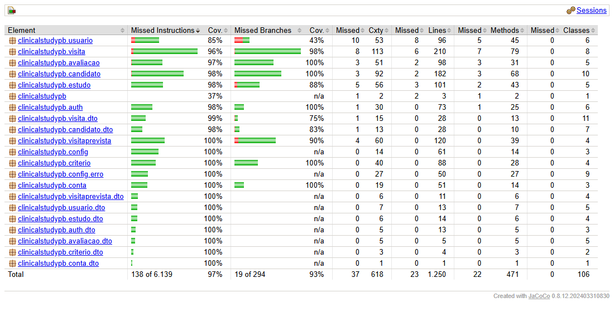

# Release 2: Acompanhamento do participante

Documentação da segunda release do ClinicalStudyPB, que reúne as sprints seguintes à Release 1. Ela cobre a conta do participante, o agendamento e o status das visitas, os resultados fictícios, o histórico, a retirada e o app do participante. Todos os dados são fictícios.

- **Período:** a preencher.
- **Tag:** a preencher.
- **GitHub Release:** a preencher.
- **Release anterior:** [Release 1](../release1/README.md)
- **README principal:** [`README.md`](../../README.md)
- **Modelo de dados:** [`MER-v3.md`](../../Docs/ClinicalStudyPB-Docs/Diagramas/MER-v3.md)

## 1. Requisitos da release: situação final

Preencher ao fim da release e justificar os parciais.

| RF | Requisito | Sprint | Concluído | Parcial | Não implementado | Justificativa |
| --- | --- | --- | --- | --- | --- | --- |
| RF12 | Agendar visitas dos participantes | | ☐ | ☐ | ☐ | |
| RF13 | Registrar comparecimento, ausência ou cancelamento | | ☐ | ☐ | ☐ | |
| RF14 | Registrar resultados fictícios das avaliações | | ☐ | ☐ | ☐ | |
| RF15 | Histórico de visitas e resultados | | ☐ | ☐ | ☐ | |
| RF16 | Retirada do participante | | ☐ | ☐ | ☐ | |
| RF17 | App: estudos do participante | | ☐ | ☐ | ☐ | |
| RF18 | App: visitas do participante | | ☐ | ☐ | ☐ | |

## 2. Sprints

| Sprint | Período | Objetivo | Documento |
| --- | --- | --- | --- |
| 3 | | | a criar em `sprints/sprint-3.md` |

Pendências herdadas da Release 1:

- [Data e hora nas visitas](sprints/pendencia-visitas-data-hora.md)

## 3. Evidências

| Evidência | Onde encontrar |
| --- | --- |
| Relatório de testes e cobertura | a preencher (`relatorio-testes.md`); parcial de 22/11 na seção 4 |
| Capturas de tela (web e app) | a preencher (`img/`) |
| Regressão de RF01 a RF18 e bug bash | [`Testes/`](../../Docs/ClinicalStudyPB-Docs/Testes/) |
| Contrato OpenAPI | [`openapi.yaml`](../../Docs/ClinicalStudyPB-Docs/api/openapi.yaml) |

## 4. Cobertura do backend (parcial, 22/11/2026)

Task T-112. Conferência feita depois dos merges de visitas, conta do participante, resultados e retirada (PRs #54 e #60).

- **Commit medido:** `283fd10` da `develop` (merge do PR #59).
- **Execução:** `./mvnw clean verify` com PostgreSQL 17 em container, como no CI. **548 testes, todos passaram.**
- **Regra do CI:** a `cobertura-minima` do `pom.xml` exige 80% de linhas em cada pacote, sem `config` e sem DTOs. Ela foi cumprida ("All coverage checks have been met"). Todo PR que deixar um pacote abaixo de 80% falha no CI.
- **CI:** roda backend, web e mobile (typecheck e testes) em todo PR.

| Pacote | Linhas cobertas | Cobertura |
| --- | --- | --- |
| `auth` | 73 de 73 | 100% |
| `avaliacao` | 96 de 98 | 98,0% |
| `candidato` (inclui a retirada, RF16) | 180 de 182 | 98,9% |
| `conta` (conta do participante) | 51 de 51 | 100% |
| `criterio` | 88 de 88 | 100% |
| `estudo` | 98 de 101 | 97,0% |
| `usuario` | 88 de 96 | 91,7% |
| `visita` (agendamento, status e resultados, RF12 a RF14) | 204 de 210 | 97,1% |
| `visitaprevista` | 120 de 120 | 100% |
| **Total das linhas de negócio** | **998 de 1.019** | **97,9%** |

Classes novas da Release 2: `RetiradaService`, `ResultadoService`, `ContaParticipanteService` e os controllers estão com 100%. `VisitaService` está com 97,2%, `Visita` com 94,3% e `ResultadoAtividade` com 91,7%. Nenhum pacote ficou abaixo de 80%, então não há classes a cobrar no grupo.

**Ainda não medido:** o histórico (RF15) e os endpoints do app do participante (RF17 e RF18) ainda não estavam na `develop` nesta data. A regra do CI vale para eles quando entrarem, e a medição final vai para o `relatorio-testes.md` no fechamento da release.

