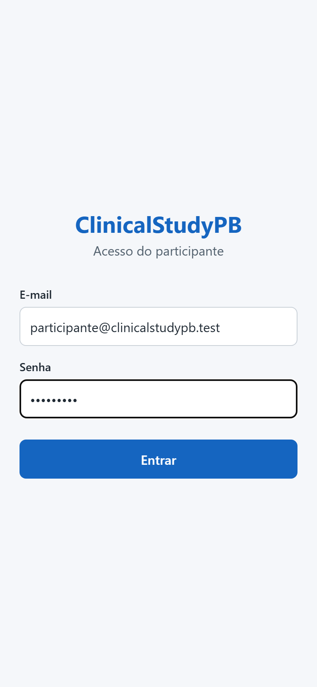
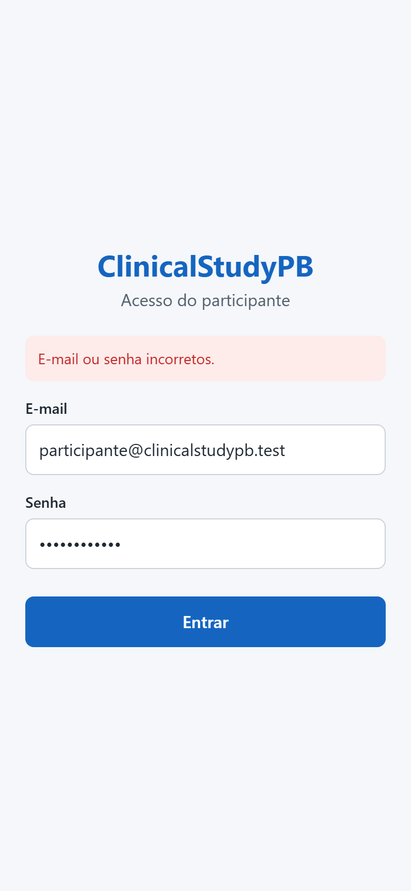
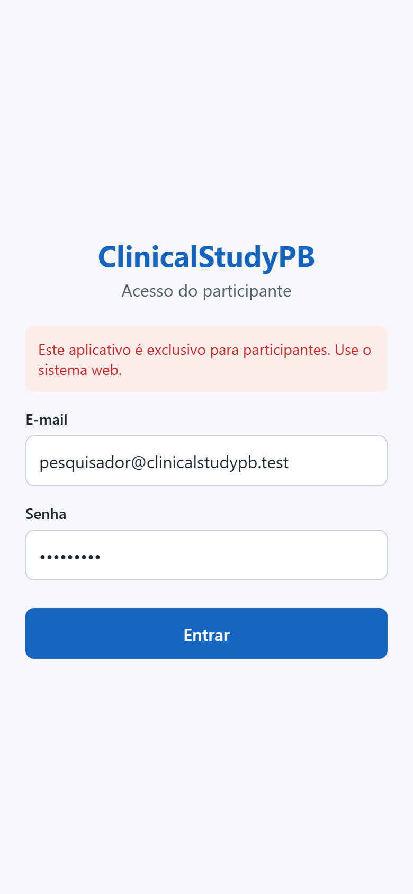
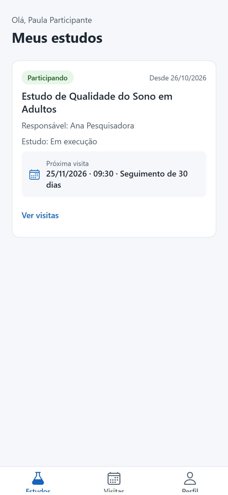
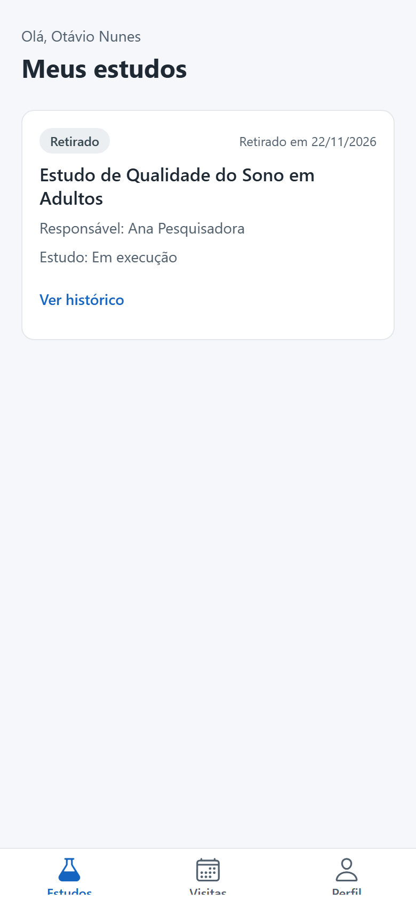
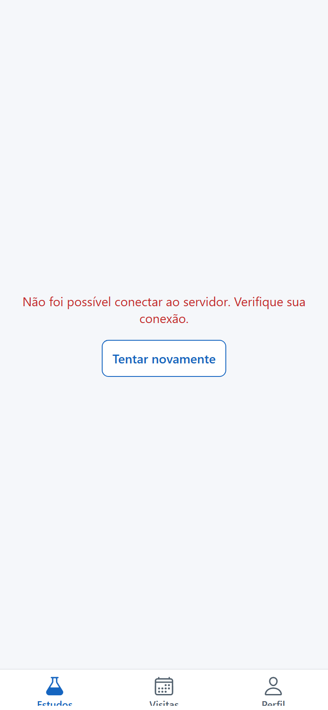
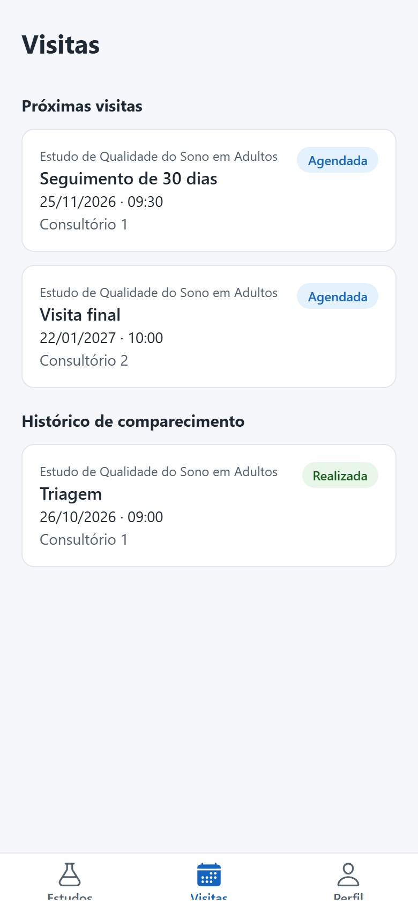
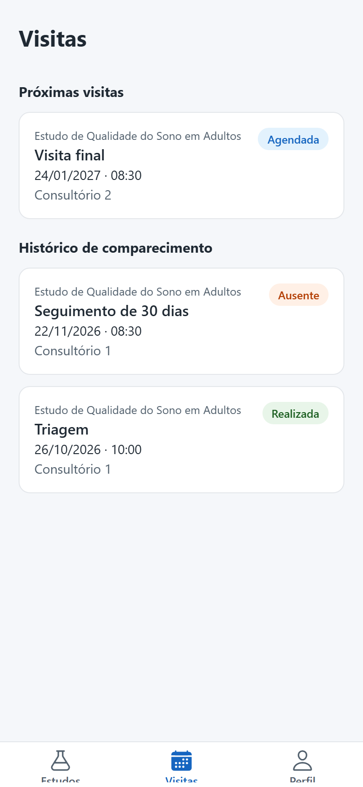
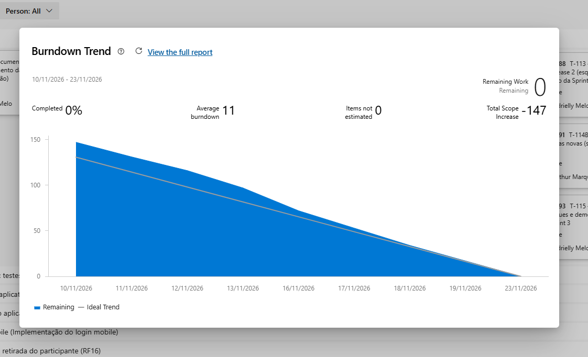

# Release 2: Acompanhamento do participante

Documentação da segunda release do ClinicalStudyPB, que reúne as Sprints 3 e 4. Ela cobre a conta do participante, o agendamento e o status das visitas, os resultados fictícios, o histórico, a retirada, o app do participante e o monitoramento (painel e relatório). Todos os dados são fictícios.

- **Período:** 10/11/2026 a 07/12/2026 (Sprints 3 e 4).
- **Tag:** a preencher.
- **GitHub Release:** a preencher.
- **Release anterior:** [Release 1](../release1/README.md)
- **README principal:** [`README.md`](../../README.md)
- **Modelo de dados:** [`MER-v3.md`](../../Docs/ClinicalStudyPB-Docs/Diagramas/MER-v3.md)

## 1. Requisitos da release: situação final

Preencher ao fim da release e justificar os parciais.

| RF | Requisito | Sprint | Concluído | Parcial | Não implementado | Justificativa |
| --- | --- | --- | --- | --- | --- | --- |
| RF12 | Agendar visitas dos participantes | 3 | ☒ | ☐ | ☐ | Agendamento com a janela da visita e agenda do estudo com filtros. Data no passado recusada na web; a API valida a janela (decisão 4 do MER v3) |
| RF13 | Registrar comparecimento, ausência ou cancelamento | 3 | ☒ | ☐ | ☐ | Só a partir de AGENDADA, motivo obrigatório no cancelamento e realizada ou ausente só depois da data |
| RF14 | Registrar resultados fictícios das avaliações | 3 | ☒ | ☐ | ☐ | Um resultado por atividade, só em visita realizada; pesquisador e administrador só consultam |
| RF15 | Histórico de visitas e resultados | 3 | ☒ | ☐ | ☐ | Página do participante com a linha do tempo das visitas e dos resultados |
| RF16 | Retirada do participante | 3 | ☒ | ☐ | ☐ | Motivo obrigatório; cancela as visitas agendadas e libera a vaga |
| RF17 | App: estudos do participante | 3 | ☒ | ☐ | ☐ | Tela Estudos com a API real, inclusive a participação retirada |
| RF18 | App: visitas do participante | 3 | ☒ | ☐ | ☐ | Tela Visitas com próximas visitas e histórico; RF19 e RF20 ocultos |
| RF19 | App: confirmar presença ou pedir reagendamento | 4 | ☐ | ☐ | ☐ | |
| RF20 | App: pedir retirada voluntária | 4 | ☐ | ☐ | ☐ | |
| RF21 | Painel com candidatos, incluídos e visitas | 4 | ☐ | ☐ | ☐ | |
| RF22 | Relatório de recrutamento e acompanhamento | 4 | ☐ | ☐ | ☐ | |

O login do app com a API real (RF02 e RF03 no app) também foi entregue na Sprint 3.

## 2. Sprints

| Sprint | Período | Objetivo | Documento |
| --- | --- | --- | --- |
| 3 | 10/11 a 23/11 | RF12 a RF16 (agendamento, status, resultados, histórico e retirada), login do app e RF17 e RF18 no app | [sprint-3.md](sprints/sprint-3.md) |
| 4 | 24/11 a 07/12 | RF19 a RF22 (confirmação, reagendamento e retirada pelo app, painel e relatório), integração completa e testes integrados | a criar em `sprints/sprint-4.md` |

Pendências herdadas da Release 1:

- [Data e hora nas visitas](sprints/pendencia-visitas-data-hora.md): resolvida na Sprint 3. A visita agendada (RF12) grava data e hora, dentro da janela calculada a partir da inclusão.

## 3. Evidências

| Evidência | Onde encontrar |
| --- | --- |
| Relatório de testes e cobertura | a preencher (`relatorio-testes.md`); parcial de 22/11 na seção 4 |
| Capturas de tela do app | Seção 5 |
| Protótipo de RF14 a RF16 (validado pela PO) | [`PrototiposTela/RF14-RF16/`](../../Docs/ClinicalStudyPB-Docs/PrototiposTela/RF14-RF16/) |
| Regressão de RF01 a RF18 e bug bash (42 de 43 casos aprovados) | [`bug-bash-2026-11-19.md`](../../Docs/ClinicalStudyPB-Docs/Testes/bug-bash-2026-11-19.md) |
| Contrato OpenAPI | [`openapi.yaml`](../../Docs/ClinicalStudyPB-Docs/api/openapi.yaml) |

## 4. Cobertura do backend (parcial, 22/11/2026)

Task T-112. Conferência feita depois dos merges de visitas, conta do participante, resultados e retirada (PRs #54 e #60).

- **Commit medido:** `283fd10` da `develop` (merge do PR #59).
- **Execução:** `./mvnw clean verify` com PostgreSQL 17 em container, como no CI. **548 testes, todos passaram.**
- **Regra do CI:** a `cobertura-minima` do `pom.xml` exige 80% de linhas em cada pacote, sem `config` e sem DTOs. Ela foi cumprida ("All coverage checks have been met"). Todo PR que deixar um pacote abaixo de 80% falha no CI.
- **CI:** roda backend, web e mobile (typecheck e testes) em todo PR.

| Pacote | Linhas cobertas | Cobertura |
| --- | --- | --- |
| `auth` | 73 de 73 | 100% |
| `avaliacao` | 96 de 98 | 98,0% |
| `candidato` (inclui a retirada, RF16) | 180 de 182 | 98,9% |
| `conta` (conta do participante) | 51 de 51 | 100% |
| `criterio` | 88 de 88 | 100% |
| `estudo` | 98 de 101 | 97,0% |
| `usuario` | 88 de 96 | 91,7% |
| `visita` (agendamento, status e resultados, RF12 a RF14) | 204 de 210 | 97,1% |
| `visitaprevista` | 120 de 120 | 100% |
| **Total das linhas de negócio** | **998 de 1.019** | **97,9%** |

Classes novas da Release 2: `RetiradaService`, `ResultadoService`, `ContaParticipanteService` e os controllers estão com 100%. `VisitaService` está com 97,2%, `Visita` com 94,3% e `ResultadoAtividade` com 91,7%. Nenhum pacote ficou abaixo de 80%, então não há classes a cobrar no grupo.

**Atualização de 23/11:** com o histórico (RF15) e os endpoints do app (RF17 e RF18) na `develop`, o `mvn clean verify` rodou 598 testes, todos passando, e a regra de 80% de linhas por pacote foi cumprida. No mesmo dia passaram 287 testes do frontend e 54 do app. A medição final por pacote vai para o `relatorio-testes.md` no fechamento da release.

## 5. Capturas de tela

Task 3792. Dados do seed da Release 2 (migração V14), com situações de sucesso e de erro.

### App do participante (RF02, RF03, RF17 e RF18)

Capturas do app rodando no modo web do Expo, em tela de celular (390 × 844), contra a API local. As contas são as do seed, com a senha `Senha@123`.

**Login**

| Situação | Captura |
| --- | --- |
| Formulário preenchido com a conta da participante |  |
| Erro: e-mail ou senha incorretos |  |
| Erro: perfil da equipe bloqueado no app (RF03) |  |

**Estudos (RF17)**

| Situação | Captura |
| --- | --- |
| Paula: participação ativa, com responsável e próxima visita |  |
| Otávio: participação retirada, sem próxima visita |  |
| Erro: sem conexão com o servidor, com opção de tentar de novo |  |

**Visitas (RF18)**

| Situação | Captura |
| --- | --- |
| Paula: próximas visitas e histórico de comparecimento |  |
| Lucas: ausência registrada no histórico |  |

Confirmar presença e pedir reagendamento (RF19) e o pedido de retirada pelo app (RF20) não aparecem, porque ficaram para a Sprint 4.

### Painel web

As capturas das telas web da Sprint 3 (tasks 3790 e 3791) foram dispensadas pela PO. As telas de resultados, histórico e retirada estão no [protótipo de RF14 a RF16](../../Docs/ClinicalStudyPB-Docs/PrototiposTela/RF14-RF16/), e as telas usadas na regressão, nas [evidências do bug bash](../../Docs/ClinicalStudyPB-Docs/Testes/evidencias/bug-bash-release2/).

## 6. Processo de desenvolvimento

### Sprint 3 (10/11 a 23/11)

O planejamento, as tasks, a review, o burndown, a contribuição de cada integrante e o roteiro da demonstração estão em [`sprints/sprint-3.md`](sprints/sprint-3.md). Resumo:

- **Entregue:** RF12 a RF18 e o login do app com a API real, com MER v3, contrato OpenAPI, diagramas de sequência e seed V14.
- **Pendências para a Sprint 4:** E2E do acompanhamento (task 3784) e Bug #1, em que a API deixa o administrador desativar o próprio usuário.
- **Burndown:** chegou a 0h em 23/11 e acompanhou a linha ideal a partir de 17/11, mas mede horas decrementadas, não entregas.
- **Principal melhoria:** os merges se concentraram entre 22/11 e 24/11, depois dos marcos de 13/11 a 17/11. Na Sprint 4, cada marco precisa de um PR mesclado no dia previsto, e o Remaining Work só é zerado depois do merge.

