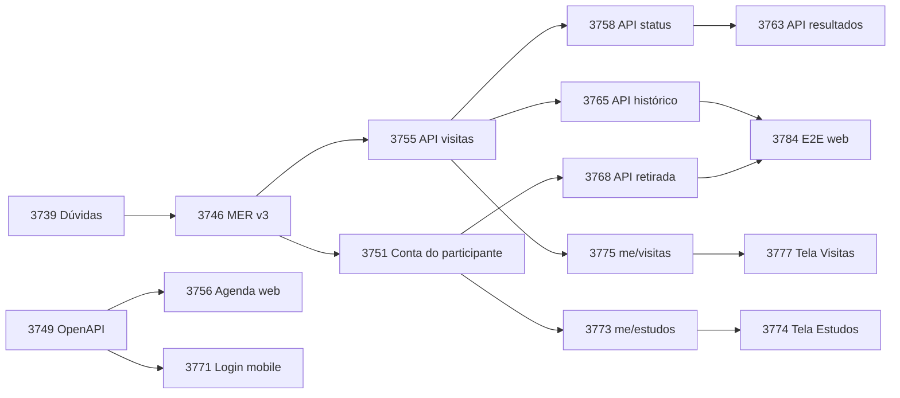
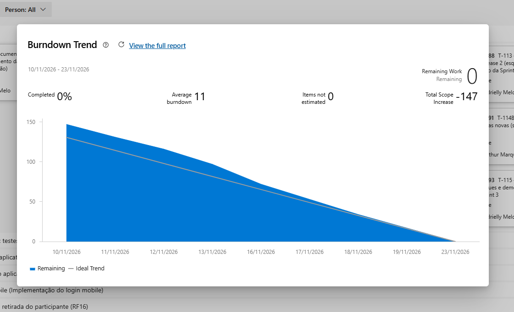

---
tags:
  - sprint
  - clinicalstudypb
  - eng-sw-2
sprint: 3
release: 2
inicio: 2026-11-10
fim: 2026-11-23
lider-da-sprint: Adrielly
status: concluído
---

# Sprint 3 — ClinicalStudyPB

> [!NOTE]
> **Navegação**
> Release 2 (Sprints 3 e 4) · Entrega em 07/12/2026 · Anterior: [sprint-2](../../release1/sprints/sprint-2.md)

## 1. Contexto geral

- **Projeto:** ClinicalStudyPB, sistema simplificado de gestão do ciclo de vida de estudos clínicos (dados fictícios, sem decisão clínica automatizada).
- **Release 2 — Acompanhamento e mobile:** acompanhamento dos participantes na web e app do participante.
- **Objetivo da Sprint 3:** entregar **RF12 a RF16** (agendamento, status das visitas, resultados, histórico e retirada) na web, o **login do app com a API real** e **RF17 e RF18** no app, mantendo RF01 a RF11 funcionando.
- **Fora do escopo:** RF19 (confirmar presença e reagendar pelo app), RF20 (retirada pelo app), RF21 e RF22 (painel e relatório), integração completa e testes integrados entre web, mobile e backend. Tudo isso é da Sprint 4.
- **Rotação de papéis:** cada integrante assume um papel diferente a cada sprint. Testes, documentação e revisão de código são **compartilhados**.

### Requisitos da sprint

| ID | Requisito | Interface |
| --- | --- | --- |
| RF12 | Agendar visitas para os participantes incluídos | Web |
| RF13 | Registrar a realização, ausência ou cancelamento de visitas | Web |
| RF14 | Registrar resultados fictícios das avaliações previstas | Web |
| RF15 | Consultar o histórico de visitas e avaliações de um participante | Web |
| RF16 | Registrar a retirada de um participante do estudo | Web |
| — | Login do app com a API real (RF02 e RF03 no app) | Mobile |
| RF17 | Consultar os estudos em que o participante está incluído | Mobile |
| RF18 | Exibir as próximas visitas e o histórico de comparecimento | Mobile |

### Equipe e papéis nesta sprint

| # | Papel | Responsável | Foco | Horas planejadas |
| --- | --- | --- | --- | --- |
| 1 | Product Owner / Gerente | Adrielly | Planejamento, dúvidas e decisões de negócio, contrato OpenAPI, backend de resultados (RF14) e retirada (RF16), aceite e documentação da Release 2 | 28h |
| 2 | Desenvolvedora Backend | Jasmine | MER v3, conta do participante, agendamento (RF12) e status das visitas (RF13) | 28h |
| 3 | Desenvolvedor Web 1 | Arthur | Protótipo e telas de resultados (RF14), histórico (RF15, com o backend) e retirada (RF16) | 28h |
| 4 | Desenvolvedor Web 2 | Nidlan Hendell | Protótipo e telas de agenda e agendamento (RF12), status das visitas (RF13) e acesso do participante na inclusão | 28h |
| 5 | Desenvolvedora Mobile | Maria Eduarda | Login do app com a API, RF17 e RF18 no app e os endpoints do participante | 28h |
| 6 | QA / DevOps | Mirelle | Seed, testes de integração, E2E web, regressão, cobertura e CI | 23h |
| | | **Total** | | **163h** |

> [!NOTE]
> **Rotação**
> Na Sprint 2 os papéis eram: Gerente Mirelle, Backend Maria Eduarda, Web 1 Nidlan Hendell, Web 2 Jasmine, Mobile Arthur e QA Adrielly.

## 2. Duração da sprint

- **Período:** 10/11/2026 a 23/11/2026 (20/11 é feriado; 9 dias úteis)
- **Planning:** 10/11
- **Prazos internos:** 11/11 (resposta da professora, task 3739) e 12/11 (contrato OpenAPI, task 3749)
- **Checkpoint intermediário:** 16/11
- **Feature freeze e bug bash:** 19/11
- **Review e retrospectiva:** 23/11
- **Gerenciamento:** board e burndown no Azure DevOps

### Definição de Pronto

- Código na `develop` por PR revisado por outra pessoa (revisor rotativo).
- Testes passando no CI (unitários no backend; de componente na web e no mobile).
- Tela consumindo a API real, sem dados fictícios.
- Endpoint novo documentado no Swagger e no `openapi.yaml`.
- Card atualizado no Azure, com `AB#<id>` no commit.

### Decisões de negócio (premissas)

A professora não respondeu às dúvidas 3, 4 e 5 até 11/11, então a equipe seguiu a proposta do planning como premissa, registrada no [MER-v1](../../../Docs/ClinicalStudyPB-Docs/Diagramas/MER-v1.md) e no [MER-v3](../../../Docs/ClinicalStudyPB-Docs/Diagramas/MER-v3.md):

- As "avaliações previstas" do RF14 são as atividades da visita prevista (RF06), com um resultado por atividade e só em visita REALIZADA.
- As visitas são individuais, por participante, sem turma.
- A conta do participante é criada ou reaproveitada pelo sistema na inclusão (RF11), com a senha inicial mostrada uma única vez ao coordenador.
- A visita pertence à participação no estudo (candidato INCLUIDO), e não direto ao usuário.
- A retirada muda o status para RETIRADO, libera a vaga e cancela as visitas AGENDADAS. A conta do participante continua ativa, para o app mostrar a participação retirada (RF17).

## 3. Backlog da sprint (Issue > Task)

> [!TIP]
> **Convenção**
> Número = ID da task no Azure DevOps · Responsável · Horas estimadas · Início → fim previsto. Entre parênteses, o PR que levou a task para a `develop`.

### Issue 01 — Preparação: decisões, modelo e contrato de RF12–RF18

- [x] **3735** (T-78) Planejar a Sprint 3 e criar Issues e Tasks no Azure · Adrielly · 3h · 10/11 → 10/11 *(este documento)*
- [x] **3739** (T-79) Tirar dúvidas com a professora: avaliações, turmas, conta do participante e retirada · Adrielly · 1h · 10/11 → 10/11 *(sem resposta até 11/11; premissas registradas no MER, PR #58)*
- [x] **3744** (T-80) Diagramas de sequência do acompanhamento e do app do participante · Adrielly · 3h · 17/11 → 17/11 *(PR #59)*
- [x] **3746** (T-81) MER v3: visita, resultado de atividade, retirada e vínculo com o usuário · Jasmine · 5h · 10/11 → 11/11 *(PR #54)*
- [x] **3748** (T-82) Revisão cruzada do MER v3 · Adrielly · 1h · 12/11 → 12/11 *(PR #59)*
- [x] **3749** (T-83) Contrato OpenAPI de RF12–RF18 e da conta do participante · Adrielly · 4h · 11/11 → 12/11 *(PR #59)*
- [x] **3750** (T-84) Seed de demonstração da Release 2 (migração V14) · Mirelle · 3h · 18/11 → 18/11 *(PR #63)*

### Issue 02 — Conta de acesso do participante (RF01/RF11)

- [x] **3751** (T-85) Backend: criar ou vincular a conta PARTICIPANTE na inclusão · Jasmine · 5h · 16/11 → 17/11 *(PR #54)*
- [x] **3753** (T-86) Web: mostrar o acesso do participante na inclusão · Nidlan Hendell · 2h · 18/11 → 18/11 *(feita pela Mirelle no PR #76, em 23/11)*

### Issue 03 — Agendar visitas (RF12)

- [ ] **3754** (T-87) Protótipo da agenda, do agendamento e do registro de status · Nidlan Hendell · 4h · 10/11 → 11/11 *(dispensada pela PO em 23/11: as telas foram feitas direto no código, PR #73)*
- [x] **3755** (T-88) Backend: entidade Visita, agendamento e listagem · Jasmine · 8h · 11/11 → 13/11 *(PR #54)*
- [x] **3756** (T-89) Web: agenda de visitas do estudo · Nidlan Hendell · 5h · 12/11 → 13/11 *(PR #73; a integração com a API real entrou no PR #78, da Mirelle)*
- [x] **3757** (T-90) Web: agendar visita para um participante incluído · Nidlan Hendell · 6h · 13/11 → 16/11 *(PR #73 e PR #78)*

### Issue 04 — Registrar realização, ausência ou cancelamento (RF13)

- [x] **3758** (T-91) Backend: mudança de status da visita · Jasmine · 5h · 13/11 → 16/11 *(PR #54)*
- [x] **3760** (T-92) Web: ações de realizada, ausente e cancelada · Nidlan Hendell · 5h · 17/11 → 18/11 *(PR #73 e PR #78)*

### Issue 05 — Registrar resultados fictícios das avaliações (RF14)

- [x] **3762** (T-93) Protótipo de resultados, histórico e retirada (RF14–RF16) · Arthur · 4h · 10/11 → 11/11 *(feita pela Mirelle no PR #69, em 23/11)*
- [x] **3763** (T-94) Backend: resultados das atividades da visita · Adrielly · 6h · 13/11 → 16/11 *(PR #60)*
- [x] **3764** (T-95) Web: registrar resultados de uma visita realizada · Arthur · 6h · 17/11 → 18/11 *(feita pela Mirelle no PR #68, em 23/11)*

### Issue 06 — Histórico do participante (RF15)

- [x] **3765** (T-96) Backend: endpoint do histórico do participante · Arthur · 4h · 13/11 → 16/11 *(feita pela Mirelle no PR #67, em 23/11)*
- [x] **3766** (T-97) Web: página do participante com o histórico · Arthur · 6h · 12/11 → 16/11 *(PR #74)*

### Issue 07 — Registrar a retirada do participante (RF16)

- [x] **3768** (T-98) Backend: registrar a retirada · Adrielly · 5h · 16/11 → 17/11 *(PR #60)*
- [x] **3769** (T-99) Web: ação de registrar retirada · Arthur · 4h · 18/11 → 19/11 *(PR #75)*

### Issue 08 — Login mobile

- [x] **3771** (T-100) Mobile: login e logout com a API real · Maria Eduarda · 5h · 10/11 → 11/11 *(PR #53)*
- [x] **3772** (T-101) Mobile: configuração da API e instruções de execução · Maria Eduarda · 1h · 19/11 → 19/11 *(PR #66)*

### Issue 09 — Estudos no aplicativo (RF17)

- [x] **3773** (T-102) Backend: `GET /participantes/me/estudos` · Maria Eduarda · 3h · 17/11 → 17/11 *(PR #64)*
- [x] **3774** (T-103) Mobile: tela Estudos com a API · Maria Eduarda · 4h · 18/11 → 18/11 *(PR #65)*

### Issue 10 — Visitas no aplicativo (RF18)

- [x] **3775** (T-104) Backend: `GET /participantes/me/visitas` · Maria Eduarda · 4h · 13/11 → 16/11 *(PR #64)*
- [x] **3777** (T-105) Mobile: tela Visitas com a API e RF19/RF20 ocultos · Maria Eduarda · 6h · 12/11 → 16/11 *(PR #65)*

### Issue 11 — Qualidade: testes, regressão e cobertura

- [x] **3778** (T-106) Testes unitários: agendamento, status da visita e conta do participante · Jasmine · 5h · 17/11 → 18/11 *(PR #54)*
- [x] **3780** (T-107) Testes de integração dos endpoints de RF12–RF18 · Mirelle · 8h · 12/11 → 18/11 *(PR #62)*
- [x] **3781** (T-108) Testes de componente web (agenda, agendamento, status e acesso na inclusão) · Nidlan Hendell · 4h · 19/11 → 23/11 *(agenda no PR #73; acesso na inclusão no PR #76, da Mirelle)*
- [x] **3782** (T-108) Testes de componente web (resultados, histórico e retirada) · Arthur · 4h · 19/11 → 23/11 *(histórico e retirada nos PRs #74 e #75; resultados no PR #68 e participante retirado no PR #77, da Mirelle)*
- [x] **3783** (T-109) Testes de componente mobile: login, Estudos e Visitas · Maria Eduarda · 4h · 19/11 → 19/11 *(PRs #65 e #71)*
- [ ] **3784** (T-110) E2E web: estender ao acompanhamento · Mirelle · 6h · 19/11 → 23/11 *(não entregue: a branch `test/T-110-e2e-acompanhamento-release2-clean` não tem commits; passa para a Sprint 4)*
- [x] **3786** (T-111) Roteiro de regressão e bug bash · Mirelle · 3h · 10/11 → 19/11 *(roteiro no PR #52; execução no PR #70, em 23/11)*
- [x] **3787** (T-112) Cobertura ≥ 80% e CI com os testes do mobile · Mirelle · 3h · 10/11 → 19/11 *(PRs #51 e #61)*

### Issue 12 — Documentação e acompanhamento da sprint

- [x] **3788** (T-113) README da Release 2 e registro da Sprint 3 · Adrielly · 3h · 18/11 → 23/11
- [ ] **3790** (T-114) Capturas das telas web: agenda, agendamento, status e acesso na inclusão · Nidlan Hendell · 1h · 23/11 → 23/11 *(dispensada pela PO em 23/11)*
- [ ] **3791** (T-114) Capturas das telas web: resultados, histórico e retirada · Arthur · 1h · 23/11 → 23/11 *(dispensada pela PO em 23/11)*
- [x] **3792** (T-114) Capturas das telas do app · Maria Eduarda · 1h · 23/11 → 23/11 *(PR #72)*
- [x] **3793** (T-115) Aceite das Issues e demonstração da Sprint 3 · Adrielly · 2h · 23/11 → 23/11 *(seção 7)*

### Tarefas compartilhadas (todos)

- [x] Bug bash em conjunto e correção dos defeitos (T-111b)
- [x] Revisão de código cruzada em todos os PRs (T-116)
- [x] Parte de cada um no README da Release 2 (T-117)

## 4. Distribuição por membro

| # | Papel | Responsável | Horas | Tasks |
| --- | --- | --- | --- | --- |
| 1 | Product Owner / Gerente | Adrielly | 28h | 3735, 3739, 3744, 3748, 3749, 3763, 3768, 3788, 3793 |
| 2 | Desenvolvedora Backend | Jasmine | 28h | 3746, 3751, 3755, 3758, 3778 |
| 3 | Desenvolvedor Web 1 | Arthur | 28h | 3762, 3764, 3765, 3766, 3769, 3782, 3791 |
| 4 | Desenvolvedor Web 2 | Nidlan Hendell | 28h | 3753, 3754, 3756, 3757, 3760, 3781, 3790 |
| 5 | Desenvolvedora Mobile | Maria Eduarda | 28h | 3771, 3772, 3773, 3774, 3775, 3777, 3783, 3792 |
| 6 | QA / DevOps | Mirelle | 23h | 3750, 3780, 3784, 3786, 3787 |
| | **Total** | | **163h** | |

## 5. Horas planejadas por dia

Linha ideal do burndown: total de 163h menos as horas acumuladas planejadas até o fim de cada dia.

| Dia | Data | Evento | Adrielly | Jasmine | Arthur | Nidlan | Maria Eduarda | Mirelle | Total do dia | Restante ideal |
| --- | --- | --- | --- | --- | --- | --- | --- | --- | --- | --- |
| 1 | 10/11 | Planning | 4 | 4 | 3 | 3 | 3 | 3 | 20 | 143 |
| 2 | 11/11 | Prazo da professora (3739) | 3 | 4 | 1 | 1 | 2 | 1 | 12 | 131 |
| 3 | 12/11 | OpenAPI e MER v3 publicados | 2 | 4 | 3 | 3 | 3 | 1 | 16 | 115 |
| 4 | 13/11 | Backend de visitas mergeado | 3 | 4 | 3 | 4 | 3 | 2 | 19 | 96 |
| 5 | 16/11 | Checkpoint intermediário | 6 | 5 | 4 | 4 | 4 | 2 | 25 | 71 |
| 6 | 17/11 | Retirada e conta do participante | 5 | 4 | 3 | 3 | 3 | 2 | 20 | 51 |
| 7 | 18/11 | Seed e testes de integração | 1 | 3 | 5 | 4 | 4 | 4 | 21 | 30 |
| 8 | 19/11 | Feature freeze + bug bash | 1 | 0 | 4 | 3 | 5 | 5 | 18 | 12 |
| 9 | 23/11 | Review e retrospectiva | 3 | 0 | 2 | 3 | 1 | 3 | 12 | 0 |
| | | **Total** | **28** | **28** | **28** | **28** | **28** | **23** | **163** | |

### Dependências críticas

## 6. Registro da sprint

### Review

#### O que foi entregue
- **RF12 a RF16 no backend e na web:** agendamento com janela calculada a partir da inclusão, status da visita (realizada, ausente e cancelada com motivo), resultados por atividade, histórico do participante com linha do tempo e retirada com cancelamento das visitas agendadas e liberação da vaga.
- **Conta do participante:** criada ou reaproveitada na inclusão, com a senha inicial mostrada uma única vez no diálogo de acesso.
- **App do participante:** login e logout com a API real, bloqueio dos perfis da equipe e telas Estudos (RF17) e Visitas (RF18) com os endpoints `/participantes/me/estudos` e `/participantes/me/visitas`. RF19 e RF20 ficaram ocultos para a Sprint 4.
- **Modelo e contrato:** MER v3, migrações V11 a V14, contrato OpenAPI de RF12 a RF18 e diagramas de sequência do acompanhamento e do app.
- **Qualidade:** 939 testes automatizados passando em 23/11 (598 no backend, 287 no frontend e 54 no mobile), regra de 80% de linhas por pacote do backend cumprida, CI com backend, web e mobile em todo PR, e regressão de RF01 a RF18 com 42 de 43 casos aprovados.

#### O que falta
- **E2E do acompanhamento (3784):** não foi entregue e passa para a Sprint 4. O E2E da Release 1 (recrutamento) continua passando.
- **Bug #1 (R-05, severidade média):** a API deixa o administrador desativar o próprio usuário. A tela já bloqueia. Card a criar no Azure e corrigir na Sprint 4 ([bug bash](../../../Docs/ClinicalStudyPB-Docs/Testes/bug-bash-2026-11-19.md)).
- **Bugs baixos herdados da Release 1:** filtro de candidatos sem a opção "Retirado" e texto de vagas sem singular ("1 vagas").
- **Data no passado no agendamento:** a web recusa, mas a API valida só a janela da visita (decisão 4 do MER v3). Se a janela incluir dias passados, a API aceita a data.

#### O que melhorar
- **Merges concentrados no fim da sprint:** os marcos de 13/11, 16/11 e 17/11 não foram cumpridos. 22 dos 28 PRs da sprint foram mesclados entre 22/11 e 24/11, e o bug bash planejado para 19/11 só foi executado em 23/11.
- **Tasks feitas por outra pessoa sem aviso no board:** a Mirelle assumiu seis tasks de Web 1 e Web 2 (3753, 3762, 3764, 3765 e as integrações das tasks 3756 e 3757). O responsável no Azure precisa ser trocado quando a task muda de mãos.
- **CI vermelho mesclado:** o PR #74 entrou com o build do frontend quebrado (chaves duplicadas em `permissoes.ts`), corrigido no merge do PR #75. Só mesclar com o CI verde.
- **Dados simulados na tela:** a agenda do PR #73 caía em `localStorage` quando a API respondia 403 ou 404, contra a Definição de Pronto. Corrigido no PR #78.
- **Commits sem `AB#`** e títulos fora do padrão (PR #73 e o título "eat(web)" do PR #76).

#### Impedimentos encontrados
- A professora não respondeu às dúvidas 3, 4 e 5. A equipe seguiu as premissas do planning.
- As telas web dependiam dos endpoints de visitas, resultados e histórico, que só entraram na `develop` em 17/11 (PR #54), 22/11 (PR #60) e 23/11 (PR #67).

#### Ações de melhoria para a Sprint 4
- [ ] Proteger a `develop` exigindo CI verde e uma revisão antes do merge.
- [ ] Checkpoint de 16/11 com merge real: PR aberto no dia previsto, mesmo que pequeno.
- [ ] Trocar o responsável no Azure sempre que outra pessoa assumir a task.
- [ ] Zerar o Remaining Work de uma task só depois do merge do PR dela, e então mover para Done.
- [ ] Entregar o E2E do acompanhamento logo no início da sprint.

### Burndown

**Análise (planejado x realizado):**

- **10/11 a 16/11, acima da linha ideal:** o restante começou em cerca de 147h e ficou de 10h a 15h acima do ideal até o checkpoint (cerca de 72h em 16/11).
- **17/11 a 23/11, na linha ideal:** o real encostou no ideal em 17/11 e chegou a **0h em 23/11**, com média de 11h por dia.
- **Leitura:** diferente da escada da Sprint 2, o Remaining Work foi atualizado todo dia, seguindo as horas a decrementar do planejamento. Mas o gráfico mede horas decrementadas, não entregas: 22 dos 28 PRs só foram mesclados entre 22/11 e 24/11. Por isso o burndown parece no prazo, enquanto o trabalho na `develop` atrasou. Na Sprint 4, só zerar o Remaining Work de uma task depois que o PR dela for mesclado.
- O relatório mostra "Completed 0%" e "Total Scope Increase -147", o que indica que as tasks tiveram o Remaining Work zerado mas ainda não foram movidas para Done no Azure.

### Contribuição por integrante

| # | Papel | Responsável | Contribuição na sprint |
| --- | --- | --- | --- |
| 1 | Product Owner / Gerente | Adrielly | Planejamento da sprint e das 12 Issues no Azure (3735), premissas das dúvidas sem resposta (3739, PR #58), revisão cruzada do MER v3 (3748), contrato OpenAPI de RF12 a RF18 com a tabela de códigos de erro (3749) e diagramas de sequência (3744), no PR #59. Backend de resultados das atividades (3763) e de retirada do participante (3768), com testes unitários, de controller e de integração, no PR #60. Revisão dos PRs da sprint, correção do teste de integração que travava o PR #78, aceite das Issues, roteiro da demo e este registro (3788 e 3793). |
| 2 | Backend | Jasmine | MER v3 (3746), conta do participante criada na inclusão (3751), agendamento de visitas com a janela (3755), status da visita (3758) e testes unitários e de integração de visitas e conta (3778), todos no PR #54, que destravou o restante da sprint. |
| 3 | Web 1 | Arthur | Página do participante com o histórico e a linha do tempo (3766, PR #74) e ação de registrar a retirada com o diálogo de motivo (3769, PR #75), com os testes de componente das duas telas (3782). O protótipo (3762), a tela de resultados (3764) e o endpoint do histórico (3765) previstos para ele foram feitos pela Mirelle. |
| 4 | Web 2 | Nidlan Hendell | Agenda de visitas do estudo, formulário de agendamento e ações de realizada, ausente e cancelada (3756, 3757 e 3760, PR #73), com testes de componente da agenda (3781), e protótipos de tela e tutorial do FigCraft (PR #57). A integração da agenda com a API real (PR #78) e o diálogo de acesso na inclusão (3753, PR #76) foram feitos pela Mirelle. |
| 5 | Mobile | Maria Eduarda | Login e logout do app com a API real e sessão expirada (3771, PR #53), endpoints `/participantes/me/estudos` e `/me/visitas` (3773 e 3775, PR #64), telas Estudos e Visitas com RF19 e RF20 desligados (3774 e 3777, PR #65), testes de componente do app (3783, PRs #65 e #71), README do mobile (3772, PR #66) e capturas das telas do app (3792, PR #72). |
| 6 | QA / DevOps | Mirelle | CI com os testes do mobile e regra do JaCoCo por pacote (3787, PRs #51 e #61), roteiro de regressão de RF01 a RF18 e execução do bug bash (3786, PRs #52 e #70), testes de integração de RF12 a RF18 (3780, PR #62) e seed da Release 2 (3750, PR #63). Também fez tasks de outras áreas: endpoint do histórico (3765, PR #67), tela de resultados (3764, PR #68), protótipo de RF14 a RF16 (3762, PR #69), diálogo de acesso na inclusão (3753, PR #76), testes do participante retirado (PR #77) e a integração da agenda com a API real (PR #78). O E2E do acompanhamento (3784) não foi entregue. |

### Requisitos da sprint — situação final

| RF | Concluído | Parcial | Não implementado | Justificativa |
| --- | --- | --- | --- | --- |
| RF12 | ☒ | ☐ | ☐ | `POST /candidatos/{id}/visitas` com a janela da visita e sem agendamento duplicado, agenda do estudo com filtros de status e período e formulário de agendamento com data sugerida. Data no passado é recusada na web; a API valida a janela (decisão 4 do MER v3). |
| RF13 | ☒ | ☐ | ☐ | `PATCH /visitas/{id}/status` só a partir de AGENDADA, com motivo obrigatório no cancelamento e realizada ou ausente só depois da data. Ações na web só para o coordenador. |
| RF14 | ☒ | ☐ | ☐ | `PUT` e `GET /visitas/{id}/resultados`, um resultado por atividade e só em visita REALIZADA. Tela com edição para o coordenador e leitura para pesquisador e administrador. |
| RF15 | ☒ | ☐ | ☐ | `GET /candidatos/{id}/historico` e página do participante com a linha do tempo das visitas e dos resultados, para pesquisador, coordenador e administrador. |
| RF16 | ☒ | ☐ | ☐ | `POST /candidatos/{id}/retirada` com motivo obrigatório: status RETIRADO, visitas agendadas canceladas e vaga liberada. Diálogo na página do participante, só para o coordenador. |
| Login mobile | ☒ | ☐ | ☐ | Login e logout com a API real, perfis da equipe bloqueados e volta ao login com a sessão expirada. |
| RF17 | ☒ | ☐ | ☐ | `GET /participantes/me/estudos` com o usuário do token e tela Estudos com a próxima visita e a participação retirada. |
| RF18 | ☒ | ☐ | ☐ | `GET /participantes/me/visitas` com próximas visitas e histórico, tela Visitas e botões de RF19 e RF20 ocultos. |

## 7. Aceite e demonstração (23/11)

### Aceite das Issues

| Issue | Situação | Observação |
| --- | --- | --- |
| 01 Preparação | Aceita | Premissas registradas no lugar das respostas da professora |
| 02 Conta do participante | Aceita | |
| 03 Agendar visitas (RF12) | Aceita | Data no passado bloqueada só na web (decisão 4 do MER v3); protótipo 3754 dispensado |
| 04 Status da visita (RF13) | Aceita | |
| 05 Resultados (RF14) | Aceita | |
| 06 Histórico (RF15) | Aceita | |
| 07 Retirada (RF16) | Aceita | |
| 08 Login mobile | Aceita | |
| 09 Estudos no app (RF17) | Aceita | |
| 10 Visitas no app (RF18) | Aceita | |
| 11 Qualidade | Com pendência | E2E do acompanhamento (3784) e Bug #1 (R-05) passam para a Sprint 4 |
| 12 Documentação | Aceita | Capturas web (3790 e 3791) dispensadas pela PO |

### Roteiro da demonstração

**Preparação:** `docker compose down -v` e `docker compose up -d --build` na raiz, para o seed V14 subir com as datas do dia. Web em <http://localhost:3000>, Swagger em <http://localhost:8080/api/swagger-ui.html> e app com `npx expo start` na pasta `mobile`. Senha de todas as contas: `Senha@123`.

| # | Parte | Quem apresenta | Conta | Passos |
| --- | --- | --- | --- | --- |
| 1 | Abertura | Adrielly | — | Objetivo da sprint, RFs entregues e premissas das dúvidas sem resposta. |
| 2 | Conta do participante | Nidlan Hendell | `coordenador@` | No Estudo de Adesão ao Tratamento do Diabetes Tipo 2 (em recrutamento), incluir o Rafael Souza, que está elegível e com consentimento, e mostrar o diálogo de acesso com a senha inicial. |
| 3 | Agenda e agendamento (RF12) | Nidlan Hendell | `coordenador@` | Agendar uma visita para o Rafael, mostrar a data sugerida e o erro de data fora da janela. Depois abrir a agenda do Estudo de Qualidade do Sono e filtrar por status. |
| 4 | Status da visita (RF13) | Nidlan Hendell | `coordenador@` | Cancelar uma visita agendada (tentar sem motivo e depois com motivo) e tentar marcar como realizada uma visita futura, que a API recusa com `VISITA_AINDA_NAO_OCORREU`. |
| 5 | Resultados (RF14) | Arthur | `coordenador@` e `pesquisador@` | Abrir a triagem realizada da Paula, editar um resultado e salvar. Entrar como pesquisador e mostrar a mesma tela só para leitura. |
| 6 | Histórico e retirada (RF15 e RF16) | Arthur | `coordenador@` | Abrir o histórico da Paula. Registrar a retirada do Lucas com motivo e mostrar a visita final cancelada, o selo Retirado e o contador de vagas. |
| 7 | API e contrato | Jasmine | — | No Swagger, mostrar as rotas de visitas e um erro 409 com código. |
| 8 | App do participante (RF17 e RF18) | Maria Eduarda | `participante@` e `participante4@` | Login da Paula, tela Estudos com a próxima visita e tela Visitas com o histórico. Login do Otávio, com a participação retirada. Tentar entrar com `coordenador@` para mostrar o bloqueio. |
| 9 | Qualidade | Mirelle | — | CI verde no último PR, cobertura do backend e resultado da regressão (42 de 43 casos e Bug #1). |
| 10 | Encerramento | Adrielly | — | Pendências (E2E e Bug #1) e o que entra na Sprint 4. |
